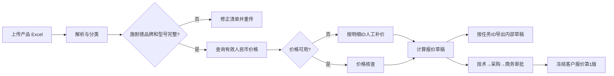

# 电气产品 AI 智能报价 Agent

一个面向电气产品销售与采购场景的本地 Web 报价工具。用户上传 Excel 产品清单时可指定报价来源：本地价格库或人工录价当前可用；网页与外部报价软件/ERP选项可见，但需完成对应适配器后才能使用。系统解析产品信息、核对品牌和型号、匹配可用价格、计算报价草稿，并支持审批和 Excel/Word 导出。

这个项目的重点不是让 AI 直接“猜价格”，而是把大语言模型放在适合它的位置：负责理解自然语言和辅助查询；产品匹配、金额计算、权限控制和审批流程由明确的规则与程序完成。这样可以让报价过程更容易检查、复现和追责。

## 项目适合什么场景

它适合用于以下类型的学习、原型验证和内部流程改造：

- 销售人员根据客户产品清单快速生成报价草稿
- 采购或技术人员核对品牌、型号、规格和价格来源
- 在报价前补充缺失价格，并保留人工操作记录
- 研究如何把 Excel、规则引擎、审批流程和 AI 助手组合成一个 Agent

当前示例以施耐德电气产品和人民币报价为演示对象，产品资料与价格均不能直接视为真实供应商报价。

产品主数据候选资料目前以[施耐德电气中国官网](https://www.schneider-electric.cn/zh/)为来源，收录在 `data_sources/schneider_cn_product_master.json`。其中记录全部为待审核草稿，未自动导入数据库、未获企业技术批准，也不代表当前供货或可直接选型。可先运行 `python -m app.product_master` 校验；只有明确执行 `python -m app.product_master --import-drafts` 才会写入本机数据库。

## 它是怎么工作的

```text
Excel 产品清单
      ↓
解析产品名称、数量、品牌、型号和规格
      ↓
检查产品信息与价格来源
      ↓
匹配价格或提示人工补价
      ↓
按固定规则计算报价草稿
      ↓
人工检查、审批并导出报价文件
```

AI 助手可以回答产品资料和任务状态相关问题，但不会直接修改价格、执行审批或发布客户报价。

## 当前版本能做什么

- 解析产品 Excel，统一常见中文列名并推断产品类别
- 只自动采用施耐德品牌、人民币、同型号规格单位且有来源凭证和有效期的本地价格
- 按合理区间和历史价格偏差核查价格
- 默认按 `成本价 × 1.2` 计算人民币草稿（加价率 20%）；金额使用 `Decimal`，单价先舍入到分再乘数量
- 提供三款施耐德候选型号的[询价表示例](templates/施耐德询价表示例.xlsx)，采购单价留空待取得正式报价
- 对缺失价格按明细 ID 完整人工补价；品牌或型号冲突需修正原始清单
- 按任务 ID 导出带报价日期、有效期和计算依据的人民币内部草稿
- 任务重启恢复、重复补价幂等和旧版本覆盖保护
- 技术、采购、商务顺序审批；只有明确配置经确认的定价规则后才发布第 1 版客户报价
- 客户版只展示产品、数量、人民币单价和金额，不含成本与加价率
- 页面可输入自然语言并显示 AI 回答；先检索六款有官方来源的施耐德产品事实，再允许模型调用任务摘要、资料搜索、精确型号详情和型号比较四个只读工具；不参与定价或审批
- 提供本地询价解析离线评测工具，可按文件哈希冻结样本并逐行比较七个标准字段；工具已用合成数据验证，真实业务验收集仍待授权样本
- 内部草稿和已发布客户版均可选择 Excel 或 Word 导出
- 可选 Docker Compose 本机启动配置
- 提供浏览器操作界面和 FastAPI 接口文档

## 重要说明

这是一个可运行的原型和学习项目，不是可以直接用于生产报价的企业系统。以下内容仍需要接入真实业务后再确认：

- 真实供应商价格、税率、币种和商务条款
- 企业产品选型规则与正式报价模板
- 企业账号、权限体系、密钥管理和审计要求
- 多人并发、数据备份、数据保留和部署安全

仓库中的示例文件不包含真实客户数据、真实成本表或 API 密钥。使用真实数据前，请先完成企业内部的数据安全和业务审批。

当前需求与验收条件见 [PRD V3.1](docs/PRD.md)，代码结构和关键设计见 [SYSTEM_DESIGN](docs/SYSTEM_DESIGN.md)，分阶段开发与验收任务见 [TASKS](docs/TASKS.md)。

## 业务流程



详细设计见 [架构文档](docs/架构设计.md)。

## 技术栈

| 层级 | 技术 |
|---|---|
| Web API | FastAPI、Uvicorn |
| 流程编排 | LangGraph |
| 数据模型 | Pydantic |
| 数据处理 | pandas、openpyxl |
| 本地存储 | SQLite |
| 网页查价实验代码 | Playwright（可选，未接入自动报价） |
| 前端 | 原生 HTML、CSS、JavaScript |
| 测试 | pytest |
| 自然语言问答 | Responses API、httpx、官方产品事实词项检索（需自行配置模型与密钥） |
| Word 导出 | python-docx |

## 快速开始

建议使用 Python 3.10 或更高版本。

```bash
cd quotation-agent
python3 -m venv .venv
source .venv/bin/activate
python -m pip install -r requirements.txt
python run.py
```

启动后访问：

- 操作界面：<http://localhost:8000/static/index.html>
- API 文档：<http://localhost:8000/docs>
- 服务信息：<http://localhost:8000/>

也可以运行 `bash run.sh`。

## 使用方法

1. 打开操作界面，下载询价表示例并按客户真实需求核对型号、规格和数量；填写客户名称并选择报价来源。上传接口默认使用成本价乘 1.2，旧的 15% 参数会被拒绝。
2. 选择“本地价格库”时系统查找本地已核准价格；选择“人工录价”时跳过自动查价并转采购补录。网页与外部软件/ERP尚未接入，选择后会提示，且不会创建任务或静默改用其他来源。解析至少需要“产品名称”和“数量”；当前产品政策仍要求明确施耐德品牌和经核实的型号。
3. 系统检查产品与人民币价格。其他品牌或缺型号的行会提示修正清单；没有合格价格的施耐德行可补价。
4. 按页面显示的明细 ID 一次补齐全部待补价格，再检查报价草稿。
5. 导出人民币内部 Excel 或 Word 草稿；页面可按任务 ID 恢复已有任务。自然语言区可问当前状态与操作，回答需人工核实。
6. 若企业已核准规则与审批人，按技术、采购、商务顺序审批，再导出客户 Excel 或 Word。原型公式不能仅凭技术测试视为公司已核准。

仓库中的 `sample_products.xlsx` 包含正泰、德力西、远东等品牌，用于演示品牌拦截；它**不是**施耐德价格演示数据。

### Excel 列格式

| 字段 | 必填 | 支持的常见列名 | 示例 |
|---|---:|---|---|
| 产品名称 | 是 | 产品名称、名称、产品、product | 断路器 |
| 数量 | 是 | 数量、数量(个) | 10 |
| 型号 | 报价必填 | 型号 | 经核实的施耐德型号 |
| 规格 | 否 | 规格、参数 | 32A 2P |
| 品牌 | 报价必填 | 品牌、厂商 | 施耐德 |
| 单位 | 否 | 单位 | 个 |

上传接口允许 `.xlsx` 和 `.xls`。默认依赖主要覆盖 `.xlsx`；读取旧版 `.xls` 时可能还需安装 pandas 对应的读取引擎。

## 可选：启用网页查价

Playwright 不在默认依赖中。需要网页查价时执行：

```bash
python -m pip install playwright
python -m playwright install chromium
```

当前适配器包含震坤行和 1688，但未接入自动报价主流程。网页结构、登录要求和商品匹配可能变化；它的价格只能作为待复核候选，不能自动成为施耐德人民币成本价。正常报价流程不需要安装 Playwright。

## 配置与本地数据

`.env.example` 只保留配置名称，不包含真实密钥。复制为 `.env` 后填写的本地值不会被 Git 追踪：

```bash
cp .env.example .env
```

自然语言助手读取 `OPENAI_API_KEY` 和 `OPENAI_MODEL` 进程环境变量；可选 `OPENAI_BASE_URL` 指向兼容 Responses API 的 HTTPS 根地址。本机启动不会自动加载 `.env`，复制文件后还需在启动进程导出环境变量；Docker Compose 可从 `.env` 读取变量。未配置时问答返回 503，原有报价功能仍可使用。模型只有调用任务查询工具时，才会收到当前角色可见的任务摘要；初始请求只发送问题、可选任务 ID 和本地检索到的官方产品事实。`data_sources/schneider_products.json` 的六款真实型号均附施耐德来源与核对日期；不同地区官方资料不证明中国市场在售或正式选型，也不提供供应商人民币报价。涉及真实客户资料前，请先核对企业数据使用政策。不要把 API Key、客户数据、真实历史报价或成本表写入源码。

审批使用进程环境变量 `QUOTE_APPROVERS_JSON`：一个 JSON 数组，每项包含 `actor`（人员名）、`role`（`technical`、`procurement`、`commercial` 之一）及至少 16 字符的 `token`。三名不同人员各持一枚令牌。配置后，所有私有 API 都要求 `Authorization: Bearer <令牌>`；页面可在“访问令牌”输入框填写，当前页面关闭后不会保存。未配置时，本机草稿功能可用，审批接口返回 503。当前启动程序仅监听 `127.0.0.1`。

配置令牌后，技术角色查看任务时不返回成本和销售金额；采购角色能看成本，但销售金额和加价参数会被隐藏。采购角色才能人工录入成本；含成本的内部草稿仅允许采购或商务导出，客户版仅允许商务导出。这是本机最小角色隔离，不能替代企业正式权限体系。

商务发布还要求 `QUOTE_APPROVED_RULE_ID` 与报价项规则 ID 一致。当前草稿规则 ID 是 `draft-cost-times-1.2-v1`；请在企业确认公式、税与舍入后，才配置真实已批准的规则 ID。单独设置环境变量不能代替企业签核。身份令牌方案适合本机验证，正式部署要接入企业账号、权限与密钥管理。

运行时文件位于 `data/`：

- `data/quotation.db`：本地价格、任务、操作事件和冻结报价版本
- `data/uploads/`：用户上传的原始 Excel
- `data/` 中的 Excel、Word 报价单：生成的业务文件

这些文件已由 `.gitignore` 排除。它们可能包含成本、利润和客户信息，应单独备份并限制访问。

## API 概览

| 方法 | 路径 | 用途 |
|---|---|---|
| `GET` | `/` | 返回服务信息 |
| `POST` | `/upload` | 上传产品表并启动报价流程 |
| `GET` | `/tasks/{task_id}` | 从 SQLite 查询任务状态 |
| `POST` | `/tasks/{task_id}/confirm` | 以 `{"line-1":"12.34"}` 等明细 ID 一次提交全部待补价行 |
| `POST` | `/tasks/{task_id}/approve/{stage}` | 技术、采购、商务角色依次审批 |
| `POST` | `/assistant/chat` | 只读自然语言问答，可带任务 ID 与最多 6 条历史 |
| `POST` | `/export` | `{"task_id":"...","format":"internal","file_type":"docx"}` 导出内部 Word；`file_type` 默认 `xlsx`，`customer` 为已发布客户版 |

完整请求结构和在线调试入口见 `/docs`。

## 测试

```bash
.venv/bin/python -m pytest -q
```

当前有 125 项自动测试，覆盖 Excel 数量严格校验、离线询价解析逐行评测、价格库故障与无价区分、明确来源选择与任务恢复、中国区产品目录校验/显式导入、产品主数据版本/证据/精确候选、报价与原始询价来源追溯、金额、严格产品与人民币价格匹配、持久化、审批、冻结快照、客户字段隔离、官方产品资料检索、只读工具闸门、合成二维布局几何/DXF子集/哈希清单，以及候选 DrawingSpec 矩形转换校验。模型真实调用、CAD 软件打开验收、Docker 启动、真实浏览器和 Word 中文排版仍待目标环境验收。125 项测试只证明代码路径，不代表企业验收、真实报价准确率或可投产图纸。

### 合成二维 CAD 原型（非工程数据）

当前提供一个纯 Python 的合成布局演示，不接报价任务或施耐德产品主数据。运行后只会在 Git 忽略的 `data/` 中生成虚构的 600×400 mm 安装板矩形布局 DXF 和 `.manifest.json` 追溯清单；不可用于选型、制造或生产。

```bash
.venv/bin/python -m app.cad2d --output data/cad/synthetic_layout.dxf
```

输出包含 5 个虚构矩形元件布局，并经过本项目内部几何与 DXF 子集检查。清单记录输入/输出哈希及“未审核”状态，能发现文件后续变化；不封存输入文件，也不是防篡改存储。尚未在 AutoCAD/LibreCAD 等软件中打开，也没有安装孔、接线和工程规则。详见[二维安装板原型教程](docs/learning/19-二维安装板确定性原型.md)。

候选 `cad-agent` 的 DrawingSpec 矩形转换器目前只通过了手工构造合成 JSON 的转换和独立几何校验；没有安装或调用候选模型，也未证明实际生成质量。详见[候选 CAD 适配边界教程](docs/learning/20-cad-agent适配边界.md)。

## 可选：Docker 本机演示

本机 Python 运行已足够用于学习。安装 Docker 后可运行 `docker compose up --build`，打开 `http://127.0.0.1:8000/static/index.html`；运行数据在命名卷 `quotation_data`。Compose 只绑定本机地址，不是公网部署方案。当前开发环境没有 Docker CLI，配置尚未实测启动。详见[本机与 Docker 运行教程](docs/learning/14-本机与Docker运行.md)。

本轮需求与验收边界见[需求增量](docs/需求增量-自然语言与Word导出.md)，对应教程为[自然语言助手](docs/learning/12-自然语言只读助手.md)和[Word 导出](docs/learning/13-Word报价导出.md)。
本轮官方产品 RAG 与型号工具的边界见[需求增量](docs/需求增量-官方施耐德产品RAG与型号工具.md)，先读[资料检索教程](docs/learning/15-候选资料检索与RAG.md)，再读[工具调用教程](docs/learning/16-只读ToolCalling.md)。

## 项目结构

```text
quotation-agent/
├── app/
│   ├── main.py          # FastAPI 入口和接口
│   ├── agent.py         # LangGraph 报价流程
│   ├── models.py        # 领域数据模型
│   ├── parser.py        # Excel 解析与产品分类
│   ├── db.py            # SQLite 访问
│   ├── tools.py         # 查价与核查工具入口
│   ├── web_scraper.py   # 可选网页查价适配器
│   ├── validator.py     # 价格核查
│   ├── pricing.py       # 报价计算
│   ├── product_policy.py # 施耐德品牌与人民币价格准入
│   ├── auth.py         # 本机审批令牌与角色核对
│   ├── approval.py     # 顺序审批与客户版本发布
│   ├── exporter.py      # Excel 导出
│   ├── word_exporter.py # Word 导出
│   ├── assistant.py     # 只读自然语言问答
│   ├── knowledge.py     # 官方产品事实检索与型号比较
│   ├── retry.py         # 重试与降级
├── static/index.html    # 操作界面
├── data_sources/        # 六款施耐德官方产品事实摘录（非采购价格）
├── tests/               # 自动化测试
├── docs/
│   ├── 架构设计.md       # 系统架构与演进说明
│   └── 项目代码全解.md   # 代码学习材料
├── sample_products.xlsx # 演示输入
├── requirements.txt     # Python 依赖
├── run.py               # Python 启动入口
└── run.sh               # Shell 启动入口
```

## 当前限制

- 任务和审批记录可跨重启恢复；旧内存版中尚未写库的任务无法迁移。
- SQLite 适合单机原型；多人并发和正式业务建议迁移到受控数据库。
- 不再自动插入演示价格；旧价格缺品牌、币种或核准证据时不会自动用于报价。
- 价格查询严格匹配品牌、型号、规格和单位；`verified` 仍只是价格记录的技术标记，不能替代实名采购价核准。报价审批记录现可保存，但实名审计仍待接入。
- 新价格以十进制文本保存并用 `Decimal` 计算；旧 SQLite `REAL` 价格和网页浮点价格需要复核，企业定价口径、税及舍入政策仍待确认。
- 内部草稿包含成本和加价率；客户版有独立字段白名单和审批闸门。企业正式模板、税与商务条款尚待确认。
- 本机角色令牌和事件记录尚非企业实名身份及不可抵赖审计；未配置令牌时草稿接口可在本机访问。
- 上传已限制为最多 10 MiB，仍需加强 Excel 内容安全、限流、备份、数据保留策略及多人部署验证。

推荐改造顺序见 [架构文档](docs/架构设计.md)。
