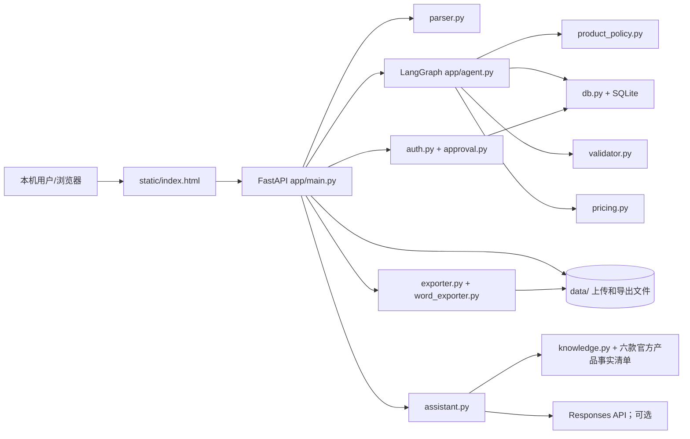
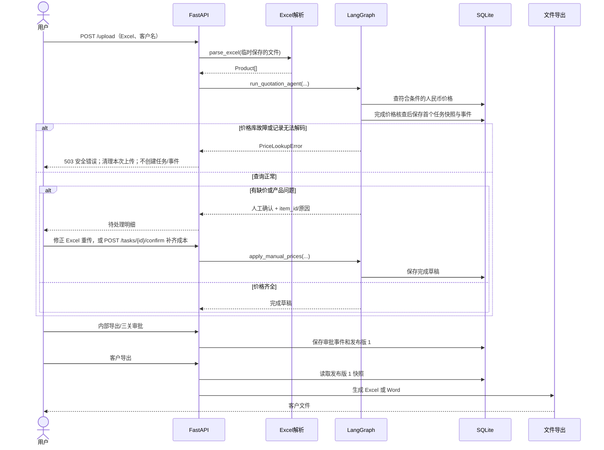

# SYSTEM_DESIGN：报价 Agent 技术设计

| 项目 | 内容 |
|---|---|
| 版本 | 1.0，2026-10-22 |
| 对应基线 | 应用 `0.5.0`；以 [PRD V3.1](PRD.md) 和当前代码为核对起点 |
| 文档用途 | 说明**当前代码如何工作**、已知设计缺口，以及报价与计划中的二维 CAD/Text-to-CAD 演进约束 |
| 状态用语 | **当前**＝代码已存在；**设计约束**＝后续开发须保持；**计划**＝尚未实现 |

业务范围见 [PRD](PRD.md)，可执行任务见 [TASKS](TASKS.md)。已有的[架构设计](架构设计.md)和[代码全解](项目代码全解.md)提供更多模块讲解；本文聚焦工程边界、接口、状态与技术决策。所有示例金额都是合成数据，不代表企业采购价。

## 1. 目标与不变量

当前系统处理字段明确的 Excel 零件清单：逐行核对施耐德品牌和型号，以人民币成本生成 `成本 × 1.2` 草稿，人工处理缺价，按技术→采购→商务顺序审批，再导出冻结第 1 版的客户 Excel/Word。自然语言窗口只查询任务与候选资料。真实供应商价、税口径、正式选型与企业定价规则未签核，系统仍是本机原型。

以下约束比具体框架更重要：

1. 没有可信的型号或价格依据时不能自动接受；缺价不能用零元代替。
2. 金额由确定性 Python 代码计算，使用 `Decimal`；模型输出不能写入报价、审批或价格库。
3. 任务“完成”不等于对外发布；客户文件只能基于通过审批的冻结快照。
4. 不同业务角色只收到其可见字段；内部成本不能出现在客户文件中。
5. 对已发布报价的变更必须生成新版本，不能覆盖历史。当前只支持第 1 版，后续版本是计划。

## 2. 系统上下文与技术选择



当前是**单进程优先的模块化单体**。FastAPI 处理 HTTP 和身份边界，Pydantic 校验领域/请求数据，LangGraph 显式编排报价节点，SQLite 保存价格、任务、事件和发布快照；pandas/openpyxl 读 Excel，openpyxl 与 python-docx 生成文件。前端为原生 HTML/CSS/JavaScript，**没有 Streamlit**。Dockerfile/Compose 仅提供可选本机包装，尚无容器实机验收。这样可保持完整业务路径可运行，避免在业务规则未定时引入多服务和消息队列。

LangGraph 当前只是确定性报价流程的图结构；任务恢复使用 `app/agent.py::TaskSnapshot` 与 `app/db.py` 的 SQLite 快照，**不是** LangGraph 内置 checkpointer。`app/web_scraper.py` 和 `app/retry.py` 是可选实验代码，未进入自动报价主链。问答中的模型工具调用是局部 AI 能力，不改变报价工作流。

## 3. 模块边界与调用契约

| 层 | 当前文件与入口 | 输入→输出及责任 |
|---|---|---|
| HTTP/页面 | `app/main.py`、`static/index.html` | 校验上传、令牌与请求；按角色构造响应；调用流程、审批、问答或导出 |
| 输入标准化 | `app/parser.py::parse_excel`、`app/models.py::Product` | Excel→产品列表；常见列名映射、关键词类别推断；不负责正式技术选型 |
| 产品/价格准入 | `app/product_policy.py::product_issue/eligible_price`、`app/db.py::search_local_price/search_approved_product_candidates`、`app/product_master.py` | 报价仍按现有硬规则检查；中国区官网草稿目录经显式命令导入，精确主数据查询只返回有证据和技术批准的型号/别名候选，不做模糊自动放行，不从官网资料推定成本 |
| 报价流程 | `app/agent.py::run_quotation_agent/apply_manual_prices` | 产品和来源选择 (`database`/`manual`)→状态与报价项；选择随任务快照持久化；网页/外部软件适配器未配置时 API 明确拒绝 |
| 金额/警告 | `app/pricing.py::calculate_item_price`、`app/validator.py::validate_price` | `Decimal` 成本→报价项；异常价格警告目前不自动阻断 |
| 持久化 | `app/db.py::save_task_snapshot/load_quote_revision` | 快照/事件/发布版本→SQLite；事务与版本冲突保护 |
| 身份/审批 | `app/auth.py::authorize`、`app/approval.py::approve_quote` | 本机 Bearer 令牌→角色；三关审批和规则闸门 |
| 文件输出 | `app/exporter.py`、`app/word_exporter.py` | 服务端任务或冻结快照→内部/客户 Excel、Word；不以客户端明细计算客户报价 |
| 问答检索 | `app/knowledge.py::search_knowledge/get_product_knowledge/compare_product_models`、`app/assistant.py::answer_question` | 问题/授权摘要→有官方来源的产品事实、型号差异与模型回答；只读、与报价分离 |
| CAD设计（合成原型） | `app/cad2d.py::generate_layout/validate_layout/render_dxf` | 仅合成 `PanelDesignSpec`→确定性矩形布局和 DXF 子集；不接报价、不持久化、不代表工程布局 |

依赖方向是 `main → 领域模块/流程 → db`。当前 `main.py` 仍同时负责部分响应字段过滤和文件导出编排；若未来拆服务，应先抽出稳定的应用服务接口和测试，再评估是否必要。

### 3.1 二维 CAD 与 Text-to-CAD（确定性合成原型已实现，业务能力待开发）

报价和 CAD 是两个独立业务工作流，通过不可变 `BOMSnapshot`、产品主数据版本及项目版本关联。CAD 生成不回写报价；若工程师修改导致 BOM/成本变化，必须创建报价新版本并走原审批链。CAD 纯布局修改也创建新的 CAD 版本，保留生成输入、产物哈希、校验报告和人工意见。

```text
已审核的 BOMSnapshot + 柜型/安装板参数 + 元器件尺寸与安装规则
    → DesignSpec（结构化、带数据来源和版本）
    → CAD2DGenerator 接口
         ├─ Template2DGenerator（确定性基线/回退）
         └─ TextToCAD2DAdapter（开源实现，兼容性验证通过后接入）
    → 隔离的生成/转换边界
    → DXF产物 + 预览
    → DXF解析与确定性几何/BOM校验
    → 失败：产生结构化错误；有界修复后重验，或转工程师
    → 通过：仍需工程师审核，存为“待审核初稿”
```

- **适配契约**：`CAD2DGenerator.generate(spec, constraints) -> CADArtifact`。`DesignSpec` 包含柜型/安装板边界、BOM项和数量、元件二维外形/安装孔/可选方向、禁布区、净空和间距约束，并记录字段来源及版本。`CADArtifact` 包含 DXF、预览、生成器标识/版本、输入快照引用和校验前元数据。缺少必要尺寸、安装信息或规则时返回可定位的缺项，不得让模型推测工程参数。
- **当前代码（仅合成）**：`app/cad2d.py` 的 `PanelDesignSpec` 仅接受 `data_class=synthetic`，样例是虚构 600×400 mm 面板、5 种虚构矩形外形和一个禁布区。`generate_layout()` 固定按 BOM 顺序横向排布；`validate_layout()` 独立检查 BOM 数量、型号/尺寸、有效边界、禁布区、碰撞和给定最小间距；错误会阻止 `render_dxf()`。渲染结果只包含矩形和 ASCII 标签，输出到运行数据目录，不关联报价任务、BOM快照或产品主数据。
- **合成产物追溯**：CLI 在 DXF 旁原子写入 sidecar JSON，保存输入规格与 DXF 文件名/内容 SHA-256、基于两者摘要生成的 artifact ID、生成器标识、校验状态和生成时间；状态固定为 `not_reviewed` 且 `engineering_use_approved=false`。验证命令路径可以检查文件是否变化。清单不复制或归档输入规格文件，不接数据库，不能防止同目录写权限用户同时替换产物和清单。
- **DXF格式边界**：目前自行写出 AC1015 ASCII DXF 的 LINE/TEXT 子集，并检查内部生成文件的区段、毫米单位标记、图层引用和实体字段；另把读回的线段和标签坐标与已校验布局逐项比对。这个检查器不是通用 DXF 解析库；尚未用 AutoCAD、LibreCAD 等目标软件打开文件，也没有工程互操作性验收。
- **Text-to-CAD边界**：T14 固定核查 [Youssef-RAPCorp/cad-agent](https://github.com/Youssef-RAPCorp/cad-agent) commit `f5e3fec5629347f8e9c6e9b2fc3dd0a607e2eeb4`。其 DrawingSpec 有矩形图元，`app/cad_agent_adapter.py` 可把带约定 BOM 实例 ID 的毫米制矩形 JSON 转为布局提案，再经项目独立校验器检查；5 个合成适配测试通过。这只验证转换器和 schema 形状，不代表候选模型实际生成过合格布局。尚未安装或运行候选包、调用模型、验证 Python 3.13 兼容性及依赖许可证。候选生成代码路径使用进程内受限 `exec`，不是本项目要求的 OS 级隔离；不得在 Web/API 进程启用。真实模型合成评测及独立沙箱验证完成前，不作为生产依赖；确定性布局仍为默认实现。
- **执行隔离**：禁止在 Web/API 主进程执行不可信生成代码。首选不执行代码的结构化输出路径。若兼容性验证证明必须执行，则放入可丢弃的隔离 worker/容器：禁网络、无应用密钥、只读输入挂载、单独临时输出目录、非特权用户，并设置 CPU、内存、文件大小和墙钟时限；只允许白名单绘图 API。解析产物并重新校验，任何执行错误、超限或异常实体都拒绝并记录，不接受模型自行宣称校验通过。
- **确定性校验**：用 DXF 解析和二维几何算法检查文件结构、BOM及数量一致、边界/禁布区、碰撞和已签核间距。验证器独立于生成器；每次自动修复后从头重新校验。几何规则不能证明接线正确、电气安全、散热或可制造性。
- **Agent与人工**：计划中的 `CADGenerationRepairAgent` 只可读取结构化校验错误，在明确工具白名单及最大修复轮数内提出修改；它不能改产品主数据、BOM、尺寸库、价格或审批状态。输入不全、持续失败或规则冲突时转工程师。自动几何校验通过仍不是工程批准。
- **存储与追溯**：DXF、预览和必要的运行日志作为文件产物存储，数据库仅保存版本、哈希、状态、引用与审核事件。每个产物关联项目版本、`BOMSnapshot`、`DesignSpec`、产品尺寸库版本、规则版本、适配器/模型版本和任务轨迹；客户成本或密钥不得写入提示或 CAD 产物。
- **第一版边界**：一个工程师确认的柜型、5–10种标准元器件、二维安装板布局；输出DXF和预览，人工审核后归档。暂不做完整接线图、原理图、通用三维建模、生产加工文件或自动投产。`TextToCAD2DAdapter` 是否采用由先行技术验证任务决定，确定性布局基线必须保留。

## 4. 报价主链：请求、状态和失败路径



`app/agent.py::build_agent` 的实际节点是 `parse → price_lookup → validate_prices → {human_review | calculate}`。`human_review` 是本次图调用的终点；补价由单独 API 调用 `apply_manual_prices` 后直接完成计算，并非图内自动等待/恢复。状态可为待处理、解析中、查价中、价格核查中、人工确认、计算中、完成；模型也定义了“错误”，但当前没有统一的错误状态节点。

产品品牌不符或缺型号时，即使用户输入成本也不得绕过，必须修正清单重新上传。合格价格来自本地 SQLite，要求产品名称/施耐德品牌/型号/规格/单位精确一致、CNY、正数、来源与凭证、有效期未过、已核准、`price_decimal` 精确文本存在。查询按 `fetched_at` 排序返回首条合格记录；多条价格的业务选价策略尚未确定。`search_local_price` 将 SQLite 读取故障和无法解码的价格记录转为 `PriceLookupError`，不再返回空列表；正常无合格记录仍返回空列表。`price_lookup_step` 和历史价格核查在首次持久化前完成，失败不会留下停在“查价中”的快照；上传 API 返回 503、清理临时询价文件，并在安全日志记录 task/item ID 与故障类别。

`parse_excel` 现在以 `dtype=object` 保留 Excel 单元格类型，并通过 `_parse_quantity` 拒绝缺失、布尔、文本、小数、非有限、非正以及超出 Excel 15 位精确整数范围的数量；错误包含工作表数据行位置（假设首行为表头）。空产品名行仍跳过，主要覆盖默认工作表；`.xls` 可能缺读取引擎。上传接口限制后缀 `.xlsx/.xls`、非空和 10 MiB；解析失败会删除临时文件并在创建报价任务前返回 400。查价数据故障返回 503 并删除本次文件。不能把通过后缀检查当作内容安全检查。

## 5. 金额、版本与持久化

当前规则 ID：`draft-cost-times-1.2-v1`，币种 `CNY`。`app/pricing.py` 先把输入转成有限 `Decimal`，计算：

```text
销售单价 = (成本 × (1 + 0.20) × 折扣).quantize(Decimal("0.01"), ROUND_HALF_UP)
行金额   = 已舍入销售单价 × 数量
总金额   = 各行金额之和
```

对外上传接口只接受默认 20% 加价率；正常流程折扣为 1。代码中 `profit_rate` 是兼容旧接口的字段名，业务含义是**成本加价率**，不是毛利率。税、运费、辅材、人工与正式折扣策略尚无企业规则。自动价格的 `QuotationItem` 与冻结快照现在保存价格记录 ID、来源凭证标识、有效期、凭证状态、金额和规则 ID；人工价格标记“待采购凭证”。上传任务保存随机文件 ID、扩展名和 SHA-256，可在受控 `data/uploads/` 目录中定位并校验原件。客户原始文件名和绝对路径不持久化；文件备份、留存期限和删除流程仍待定义。

`data/quotation.db` 的表：

| 表 | 当前用途 | 关键约束 |
|---|---|---|
| `price_records` | 本地价格与元数据；`price_decimal TEXT` 保存精确金额，旧 `price REAL` 只为兼容 | 旧实数价格或缺元数据记录不参与自动采用 |
| `quotation_tasks` | 任务状态 JSON 快照和 `version`，包含询价文件 ID/扩展名/哈希 | 任务 ID 唯一；保存时比较预期版本；旧 JSON 缺字段时按空值加载 |
| `task_events` | 每次状态/审批操作及详情 | `(task_id, version)` 唯一；与快照同事务 |
| `quote_revisions` | 发布的完整报价快照 | `(task_id, revision_no)` 主键；当前只写入第 1 版 |
| `product_master_versions` | 产品目录的追加式版本记录 | `(product_id, version)` 主键；只追加，不覆写；已批准候选需有来源、使用依据、批准人和批准时间 |

中国区候选资料位于 `data_sources/schneider_cn_product_master.json`，默认不在应用启动时写入数据库。`python -m app.product_master` 只校验；显式执行 `python -m app.product_master --import-drafts` 才会原子导入草稿。导入器限制 `market=CN`、施耐德官方中国域名及 `approval_status=draft`；相同内容可重跑，记录冲突或版本跳跃会整批回滚。公开产品事实、数据使用许可和公司技术批准仍需分别核实。

`save_task_snapshot` 用 `BEGIN IMMEDIATE`、版本比较与单事务写入任务/事件/发布快照，避免旧状态覆盖新状态；重复相同补价和审批请求可幂等返回。上传时按内容计算 SHA-256；成功任务快照保存随机文件 ID、允许扩展名和哈希，可用受控 `UPLOAD_DIR` 定位原件并检测内容变化。报价行保存采用的 `price_records.id`、凭证标识和有效期快照，价格主表之后修改不会改写旧报价的已存字段。人工补价没有虚构凭证，状态标为“待采购凭证”。客户版字段白名单不导出供应商成本证据，技术角色接口响应也隐藏来源标识。上传文件留存、备份和删除策略尚未实现；导出文件也没有独立产物表和发送记录。SQLite 文件与业务文件都不进 Git；正式部署需要备份、恢复、访问控制和留存策略。

## 6. 审批、权限与文件边界

配置 `QUOTE_APPROVERS_JSON` 后，私有 API 要求 Bearer 令牌。`technical` 看不到成本或销售金额；`procurement` 可见成本、可补价，但不能见销售金额；`commercial` 执行最后审批和客户导出。三个关卡必须按序、不同 `actor`、有非空意见。商务发布时 `QUOTE_APPROVED_RULE_ID` 必须匹配每行规则 ID；该配置仅是程序闸门，不能代替企业书面批准。没有配置审批人时本机草稿接口可无令牌使用，审批返回 503，所以当前运行方式必须保持本机隔离。

`POST /export` 只接受 `internal/customer` 和 `xlsx/docx`。内部草稿必须是已补齐价格的施耐德人民币任务，技术角色不能导出；客户版额外要求商务角色和完整三关审批，读取冻结快照，由两个导出模块各自使用客户字段白名单。客户版不应出现成本、加价率、供应商信息。当前 Word 内容已通过测试，但企业模板和目标办公软件的中文排版未验收。

## 7. 自然语言分支：RAG 与 Tool Calling

`POST /assistant/chat` 接收最多 1000 字的问题、最多 6 条历史和可选任务 ID。若指定任务，`app/main.py::_task_response` 先按角色过滤，再构造至多 30 行的摘要。`knowledge.py` 从 `data_sources/schneider_products.json` 的六款施耐德官方产品事实做词项检索，并核对完整型号与电气参数；只接受允许的施耐德 HTTPS 来源域名。事实清单附来源和核对日期，但不是向量库、完整产品目录或供应商实时价格库。

`assistant.py` 将问题、检索片段发送到配置的 Responses API。模型可要求任务摘要、产品搜索、完整型号详情或两个型号的确定性比较四个工具；后端检查白名单及参数，最多执行两次只读工具调用；`parallel_tool_calls=False`、`store=False`。模型没有补价、审批、导出或文件写入工具。未配置 `OPENAI_API_KEY/OPENAI_MODEL` 时返回 503；调用失败返回 502，报价主链独立可用。真实模型工具选择、提示注入抵抗和企业数据传输许可尚未实测。

## 8. HTTP 接口与错误语义

| 方法/路径 | 当前用途 | 重要边界 |
|---|---|---|
| `GET /templates/inquiry` | 下载三款候选施耐德询价表示例 | 成本列留空；不得视为正式报价 |
| `POST /upload` | 上传并运行报价表，可传 `price_source=database|manual|web|software` | 默认 `database` 兼容旧客户端；`database` 查本地库，`manual` 进入采购补价；`web`/`software` 当前返回 501 且不保存上传文件；未知来源 422；另有 Excel、大小和固定加价率校验 |
| `GET /tasks/{task_id}` | 从 SQLite 恢复任务 | 按角色过滤；不存在返回 404 |
| `POST /tasks/{task_id}/confirm` | 按 `item_id` 一次补齐成本 | 角色/金额校验；冲突为 409，参数错误为 422 |
| `POST /tasks/{task_id}/approve/{stage}` | 技术、采购、商务审批 | 令牌、顺序、意见、规则闸门；非法状态为 409 |
| `POST /export` | 内部/客户 Excel 或 Word | 仅服务端任务数据；未完成或未发布返回 409 |
| `POST /assistant/chat` | 只读问答与来源 | 未配置模型为 503，模型故障为 502 |

API 定义以 `app/main.py` 和服务启动后的 `/docs` 为准。当前不存在企业客户门户、外发接口、价格维护 API 或 CAD API。未来 CAD API 需在任务状态、文件授权和 worker/超时策略定稿后另行定义；不能把规划接口描述成当前实现。

## 9. 验证、部署与演进决策

测试入口：`.venv/bin/python -m pytest -q -p no:cacheprovider`。`tests/conftest.py` 把每个测试的 SQLite 隔离到临时目录；现有测试覆盖 Excel 数量严格校验、T05 离线解析评测、价格库故障与无价区分、来源选择与恢复、中国区目录来源/状态校验及原子导入、产品主数据版本/证据/精确候选、报价来源追溯、原件哈希关联、旧快照兼容、权限过滤、金额、任务恢复与并发版本、审批、文件内容、官方产品型号约束、只读工具评测和合成 CAD 几何/DXF 子集/产物哈希追溯。125 项通过是代码回归证据；CAD 未在目标软件打开，真实模型、浏览器、Docker、正式 Word 排版和企业案例均未验收。可选 Docker Compose 绑定 `127.0.0.1:8000` 并挂载 `data/` 卷；不等于生产部署。

下一步按 [TASKS](TASKS.md) 推进：报价真实业务仍需脱敏资料、价格规则签核和企业身份/部署输入。CAD方面先由工程师确认柜型、安装数据和批准样例，再扩展合成布局模块、补 DXF 目标软件验证，并独立评测 Text-to-CAD；在兼容性、安全和质量验收通过前，不把它加入报价主链或当前运行依赖。不要先引入微服务。
