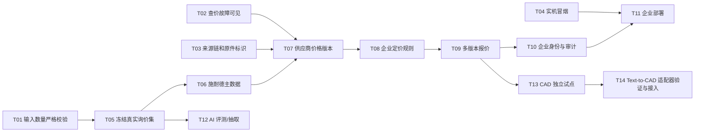

# TASKS：报价 Agent 开发计划与验收清单

| 项目 | 内容 |
|---|---|
| 计划版本 | 1.1，2026-11-01 |
| 技术基线 | 应用 `0.5.0`；需求以 [PRD V3.1](PRD.md) 为准 |
| 使用方式 | 按依赖顺序领取任务；完成后填证据、测试结果、Git 提交和教程链接 |
| 状态 | `[x]` 已有代码与自动测试且任务输入齐备；`[~]` 工程底座已完成、业务验收待资料；`[ ]` 未完成 |

技术边界见 [SYSTEM_DESIGN](SYSTEM_DESIGN.md)。本计划只写当前代码可核实的完成项和能够验收的下一步。**125 项自动测试通过不代表企业验收。** 每项开发遵循“先实现→运行适当测试→更新 `docs/learning/` 对应教程→更新学习进度”；Git 提交单独记录，避免把工作区内已有改动误提交。教学状态仍由学习者自己填写。

## 1. 已完成的原型基线（不重复开发）

### T15 [x] 新建报价时指定价格来源（原型能力）

- **实施**：前端提供本地价格库、人工录价、网页和外部软件/ERP选项；后端只执行已实现的本地价格库和人工录价路径。网页/软件选项明确返回 501，且在上传落盘前拒绝；未知值返回 422。来源写入任务快照，恢复任务仍可查看；默认 `database` 兼容旧客户端。
- **验收证据**：接口旅程测试覆盖人工来源跳过自动查价、恢复任务保留来源、网页适配器未配置时失败且不保存上传文件；项目完整回归 94 passed（`.venv/bin/python -m pytest -q -p no:cacheprovider`）。
- **边界**：网页、报价软件/ERP连接、身份认证、字段映射、来源凭证与价格准入未实现。选项表示用户意图，不代表已能访问对应系统。

| 编号 | 现有能力 | 代码/测试证据 | 未完成的业务部分 |
|---|---|---|---|
| B01 [x] | Excel 上传、常见列名映射与数据模型 | `app/main.py`、`app/parser.py`、`tests/test_parser.py`、`tests/test_upload_limits.py` | 数量输入严格校验、真实格式集 |
| B02 [x] | 施耐德/CNY/精确产品属性价格准入，缺价人工处理 | `app/product_policy.py`、`app/db.py`、`app/agent.py`、`tests/test_product_policy.py` | 企业产品主数据、供应商价格、故障区分 |
| B03 [x] | `Decimal` 草稿计算：成本 × 1.2、单价到分、行价与规则 ID | `app/pricing.py`、`tests/test_money.py` | 税、折扣与完整成本范围签核 |
| B04 [x] | SQLite 任务快照/事件、恢复、版本冲突和补价幂等 | `app/db.py`、`tests/test_task_persistence.py` | 原件/来源链、备份和多用户验收 |
| B05 [x] | 本机三角色顺序审批与冻结客户报价第 1 版 | `app/auth.py`、`app/approval.py`、`tests/test_approval.py` | 企业身份、变更版、正式审批矩阵 |
| B06 [x] | 内部/客户 Excel 与 Word、客户字段隔离 | `app/exporter.py`、`app/word_exporter.py`、`tests/test_quote_journey.py` | 正式模板、目标软件人工验收 |
| B07 [x] | 自然语言窗口、六款官方产品事实检索、四个只读工具和确定性型号比较 | `static/index.html`、`data_sources/schneider_products.json`、`app/knowledge.py`、`app/assistant.py`、`tests/test_chat.py` | 真实模型、授权完整目录和业务问题评测 |

已实现功能不等于生产可用。历史标签 `v0.4.0-prototype` 标记前一代码原型；本轮 `v0.5.0-prototype` 增加官方产品 RAG 和型号工具。尚无远程 Git 备份。

## 2. 优先级与依赖图



这张图表示**业务上最稳妥的顺序**，不是所有任务都必须串行。T01–T04 可在等待企业资料时独立推进；T05–T08 需要真实或经许可的脱敏输入。T12 的只读问答评测可先于多版本，非结构化抽取须等标注集。CAD 不能仅靠现有三款外形尺寸启动。

## 3. 下一迭代：不依赖企业新资料的工程任务

### T01 [x] 拒绝不可靠 Excel 数量（PRD F01）

- **原因**：原实现用 `int(...)` 截断小数、把缺失数量默认成 1；pandas 默认类型推断还可能把文本数字当作数值。
- **实施**：`app/parser.py` 用 `dtype=object` 保留 Excel 单元格类型，并通过 `_parse_quantity` 拒绝空值、布尔值、文本、小数、非有限值、非正数及超过 Excel 15 位精确整数范围的数量；错误包含原表行号。空产品名行继续按现有规则跳过。
- **改动位置**：`app/parser.py`、`tests/test_parser.py`、`tests/test_upload_limits.py`、`docs/learning/02-Excel输入与数据模型.md`、`docs/learning/学习进度.md`。
- **验收证据**：解析/上传定向测试 16 passed；完整回归 `.venv/bin/python -m pytest -q -p no:cacheprovider` 为 72 passed。上传坏数量返回 400，错误含 Excel 行号，报价任务函数未调用，临时文件已清理。
- **边界**：15 位上限用于防止 Excel 数值精度丢失，不是企业最大订购量；空产品名行的忽略行为沿用旧逻辑，实际询价模板仍需业务样本验收。

### T02 [x] 区分“无价”与“查价失败”（PRD F03/F06）

- **实施**：新增 `PriceLookupError` 区分 SQLite 读取故障和无法解码的价格记录；正常无合格记录仍返回空结果。报价任务先完成查价与历史核查，再写首个快照；上传失败返回 503、删除本次临时文件。日志只记录错误类别、task_id 和 item_id，不记录异常原文。
- **改动位置**：`app/db.py`、`app/agent.py`、`app/main.py`、`tests/test_database_failures.py`、`tests/test_inquiry_template.py`、`tests/test_quote_journey.py`、教程 03/04/08、README、PRD 与 SYSTEM_DESIGN。
- **验收证据**：价格库读取失败、记录损坏、历史价格读取失败、HTTP 503 无任务/事件/临时文件、健康数据库无价仍进入人工确认均有合成测试。相关测试 21 passed；完整回归 `.venv/bin/python -m pytest -q -p no:cacheprovider` 为 77 passed。

### T03 [x] 完整保存报价来源链（PRD F03/F06）

- **实施**：复用 `price_records.id` 作为稳定价格记录标识；自动报价项和冻结快照保存该 ID、来源凭证标识、有效期、证据状态、成本和原有规则 ID。人工补价标记为“待采购凭证”，不填造凭证。上传文件按随机 ID 和 `.xlsx`/`.xls` 扩展名保存在受控目录，任务快照记录文件 ID、扩展名和流式计算的 SHA-256；不存原始文件名/绝对路径。内部 Excel 审计页增加来源字段；技术角色响应和客户导出不暴露供应商凭证字段。
- **改动位置**：`app/models.py`、`app/db.py`、`app/agent.py`、`app/main.py`、`app/exporter.py`、`tests/test_provenance.py`、`tests/test_product_policy.py`、`tests/test_money.py`、教程 03/08、README、PRD 与 SYSTEM_DESIGN。
- **验收证据**：定向追溯/模型/报价旅程测试 29 passed；完整回归 `.venv/bin/python -m pytest -q -p no:cacheprovider` 为 81 passed。测试证明价格主表凭证后来变化时旧任务快照仍保留原凭证字段、上传原件哈希可复算、旧快照缺少新字段仍可读取、技术角色隐藏凭证字段、人工补价不会伪装成核准凭证。
- **边界**：没有实施上传文件的备份、访问下载接口、留存期限或删除策略；哈希只能发现内容不一致，不能阻止具备目录写权限的人替换文件。真实采购凭证与审核流程未验证。

### T04 [x] 形成可复现的实机冒烟记录（PRD F08/F09/F14）

- **原因**：现有 81 项自动测试包含接口与模型协议模拟；真实浏览器、目标 Word/Excel、Docker 和真实模型未验收。
- **实施**：用**合成数据**走上传→补价→审批→内部/客户 Excel/Word，逐项记录浏览器表现和文件版式；有 Docker CLI 才验证 Compose 与数据卷；有模型授权/密钥才测真实问答与工具调用。把环境、命令、截图/问题和结论放入不含客户信息的验收记录。
- **改动位置**：优先 `docs/` 的验收记录；发现缺陷再改相应代码和教程 05/12/13/14。
- **验收**：每项标“通过/失败/未具备条件”，不能把未执行项写成通过；文件不泄露成本；服务重启后任务可恢复。容器或模型条件缺失不阻止完成其他任务。
- **2026-11-01 本机执行记录**：合成询价上传、缺价人工确认、采购补价、三关审批、客户版发布、四种导出接口、应用重启恢复均已走通；客户版 XLSX/DOCX 内容检查未发现成本/加价率/供应商字段。客户和内部 XLSX 均在 Microsoft Excel 完成屏幕视图检查；客户和内部 DOCX 均在 Microsoft Word 确认单页且主要内容可读。完整验收记录见[本机合成数据冒烟记录](acceptance/T04-本机合成数据冒烟记录.md)。T04 的本机合成数据冒烟范围完成；Docker 与真实模型明确为未具备条件，不代表已验证。正式模板、打印机差异和企业业务验收仍未验证。

## 4. 业务资料到位后的报价试点

### T05 [ ] 建立脱敏冻结验收集（PRD F01/F12；依赖 Q01）

- **输入**：业务负责人提供至少 5 类真实格式的可用脱敏询价，标注原始行、型号、数量、单位、预期拦截/澄清原因；取得使用许可。
- **实施**：定义样本目录、版本、数据许可、人工金标准和评测脚本；敏感原件留在受控存储，不提交 Git。先让当前解析器运行，记录差异，再按差异改列映射。
- **验收**：每次评测可复现；逐行有预期与实际、差异类别和人工裁定；公开仓库只有合成夹具与汇总指标。无真实资料时状态保持“待资料”，不得以示例询价表充数。
- **2026-11-01 工具准备进展**：新增 `parse_excel_with_rows`，保留解析行对应的 Excel 物理行号；新增 `app.inquiry_evaluation`，支持 SHA-256 冻结、逐行字段对照、预期拦截类别、开发/验收拆分、至少五类格式覆盖提示和本地详细报告。评测数据被限制在本地 `data/evaluation/` 子目录，`.gitignore` 排除 `/data/`。本轮只使用合成表，未导入业务文件；定向测试 27 passed，完整回归 92 passed；一个合成明细的命令行冒烟匹配七个标准字段且报告业务验收未就绪。T05 仍未完成，需获准脱敏样本与逐行业务金标准。规范见[ T05 验收集与评测规范](acceptance/T05-验收集与评测规范.md)。

### T06 [~] 已建立施耐德中国区产品资料草稿目录；企业目录与技术确认待资料（PRD F02/F11；依赖 T05、Q02）

- **公开资料范围**：新增 `data_sources/schneider_cn_product_master.json`，记录从施耐德电气中国官网检索到的 A9F18216、A9F18232、LC1D09M7、XB4BA31 和已停产 LC1D099M7。只录入页面明确出现的字段；未知交易单位保持空值，生命周期未知不猜测。LC1D099M7 页面列出的停产日期和替代型号保留为待核验字段。所有记录均为 `draft`，公开页面不被视为企业授权或技术选型批准。中国目录中的 A9F18216 与其他地区旧资料 A9F77216 型号不同，不建立等价关系。
- **已实现**：`ProductMasterVersion`/`ProductEvidence` 和 SQLite 追加式版本表；`app.product_master` 检查中国市场标记、官方中国域名、结构字段和 draft 限制，并提供显式 `--import-drafts`；SQLite 批量导入具备事务回滚与重复导入幂等。精确品牌 + 完整型号/别名候选只返回每个产品最新已批准版本；不做模糊自动匹配，冲突候选全部保留供人工判断。
- **改动位置**：`data_sources/schneider_cn_product_master.json`、`app/product_master.py`、`app/models.py`、`app/db.py`、`tests/test_china_product_catalog.py`、`tests/test_product_master.py`、`docs/learning/07-人民币与施耐德产品匹配.md`。
- **合成/公开资料验收证据**：`tests/test_product_master.py` 与 `tests/test_china_product_catalog.py` 合计 7 passed；完整回归 101 passed。验证了目录来源/状态限制、停产替代记录、草稿不进入已批准候选、显式批量导入的幂等和事务回滚。测试不评估企业目录完整性或选型准确率。
- **仍未完成**：公司授权/留存依据、完整目录、交易单位、别名、实际销售状态和替代关系的技术核验、Q02 技术负责人签核，以及报价工作流的正式切换。因此 T06 仍为 `[~]`，不得写成“已完成中国区产品选型”或准确率成果。

### T07 [ ] 经采购核准的供应商价格版本（PRD F03/F11；依赖 T02/T03/T06、Q03）

- **输入**：脱敏供应商报价及采购签核字段：币种、单位、税、有效期、交期、起订量、阶梯价、来源凭证。
- **实施**：建立价格版本与受控导入/复核流程；多条有效价展示差异，企业确定选价策略前不自动取最低/最新；过期、税口径未知或单位不符时阻断自动采用。
- **改动位置**：`app/models.py`、`app/db.py`、`app/product_policy.py`、`app/agent.py`，数据库迁移和测试；新增价格主数据教程。
- **验收**：用采购签核样本逐行验证准入与来源；旧报价仍引用当时版本；没有真实价格时只能做合成数据测试。

### T08 [ ] 企业正式定价规则与审批矩阵（PRD F05/F07；依赖 T07、Q04/Q05）

- **输入**：商务、财务和技术签核的手算样例、税/运费/辅材/人工范围、舍入顺序、折扣和最低利润，以及岗位/额度审批规则。
- **实施**：把草稿 `draft-cost-times-1.2-v1` 与正式规则分开，规则有版本、生效期、批准记录；按批准矩阵执行审核，不能只设置 `QUOTE_APPROVED_RULE_ID` 就认定企业签核。
- **验收**：所有签核样例金额逐项一致；旧报价规则不可被新规则改写；缺税或缺成本项不能外发。

## 5. 生命周期、身份与交付

### T09 [ ] 报价第 2 版、退回/作废和发送记录（PRD F13；依赖 T03/T08、Q07）

- **实施**：依据真实议价/技术变更案例设计 `QuoteRevision` 父子关系、变更原因和重审；旧快照不可覆盖。客户文件关联准确版本与内容哈希，外发仅登记操作和责任人；现阶段不自动向客户发送。
- **验收**：改数量/型号/成本/条款后生成新版并重新审批；第 1 版金额、文件和审批记录保持原样；作废版不可作为当前客户版下载。新增版本/回归测试及教程。

### T10 [ ] 企业身份、任务级权限和审计策略（PRD F14；依赖 Q06）

- **实施**：与企业账号体系对接或确定受控登录方式；在 API、问答、导出和事件查询上统一检查任务归属/角色。明确审计留存、删除、管理员权限与密钥轮换；不能让管理员自动具有商务签核权。
- **验收**：无关项目人员无法通过猜任务 ID 查看数据；角色成本隔离在 API、文件、问答均成立；越权操作留审计但不改状态。新增权限测试与教程。

### T11 [ ] 备份恢复与部署验收（PRD F14；依赖 T04/T10、Q06）

- **实施**：确定单机/内网环境、数据目录、备份频率、恢复目标、日志与故障告警；验证 Docker Compose 或经批准的本机部署，演练数据库和文件一起恢复。
- **验收**：恢复后任务、事件、报价快照及文件版本一致；密钥不在镜像/Git；容器健康检查与权限有效；记录实际环境和故障演练结果。部署地点未定时不要预选云服务或微服务。

## 6. 受控 AI 与 CAD 扩展

### T12 [~] 只读产品检索合成评测底座已实现；真实问题与模型评测待数据/授权（PRD F10/F15；依赖 T05/Q06）

- **实施**：先冻结有许可的中文业务问题、可引用答案、无答案样本和越权请求，评测当前六款官方资料检索、引用、拒答、工具选择与权限。扩大产品目录时保留文档版本/来源；只有非结构化询价标注与授权到位才新增抽取，并让关键字段回到人工确认。
- **验收**：报告样本数、错误类别、人工判定和真实模型版本；无资料时不造价格/尺寸，未经授权不泄露成本，模型不能调用写工具。是否引入向量索引由数据量与评测结果决定。
- **本轮可独立完成的部分**：新增仅接受 `data_class=synthetic` 的只读检索评测器与 10 条固定案例，逐例记录来源 ID、错误类别、Exact Match、Recall@k、无答案拒答率和无答案误命中率。命令为 `.venv/bin/python -m app.knowledge_evaluation`。案例复用当前 `schneider_products.json` 检索，不调用模型、不访问任务数据库，也不改报价状态。
- **本轮证据与边界（2026-11-21）**：定向评测测试 4 passed；完整回归 105 passed；命令行运行输出 10/10 exact match、Recall@k=1.0、无答案拒答率=1.0、无答案误命中率=0.0。该合成集用于防止已知错误回归；这些数值不是业务准确率。未评估真实模型回答、引用完整性、工具选择或权限；也不证明国际来源资料适用于中国销售和选型。施耐德中国区主数据仍按 T06 保持草稿和独立审核。
- **后续代码进展（2026-11-21）**：新增 app.tool_call_evaluation 与 synthetic_tool_call_eval.json，以固定调用逐例检查 _run_tool() 对白名单工具、拒绝未知写工具、精确参数、超长参数、畸形 JSON 和缺少 call_id 的行为；工具结果的来源 ID 与合成任务上下文也被核对。命令为 .venv/bin/python -m app.tool_call_evaluation。本轮完整回归 109 passed；10/10 合成案例通过。
- **额外边界**：这是后端工具闸门和参数分派评测，不是模型工具选择评测，也不覆盖 API 身份权限；没有调用数据库、模型或写操作。通过只表示已知固定案例符合期望，不能声称真实模型安全或企业权限验收。
- **后续输入**：获准且脱敏的中文问题、答案证据、无答案/越权案例和评审人裁定；真实模型名称/版本与授权。取得这些前不计算或对外声称真实业务指标。

### T13 [~] 合成二维布局/DXF基线已实现；工程参数与业务验收待资料（PRD F16；依赖 T06/T09、Q08）

- **输入**：工程师核准的一个柜型、安装板尺寸与有效区域、孔位/禁布区、5–10 种元器件的二维外形/安装信息、方向、净空/间距规则、BOM 和批准布局样例；所有资料需有来源及版本。
- **实施**：定义共享版本引用的 `BOMSnapshot` 和结构化 `DesignSpec`；先实现确定性布局基线、DXF/预览生成和独立校验器。校验 BOM 数量、边界、禁布区、碰撞和已确认间距。保存输入快照、产物哈希、校验报告、工程师意见和修改版本。
- **验收**：缺少尺寸/约束时明确阻止生成；错误定位到元件和规则；失败图不能标记为通过；工程师审核能追溯每个尺寸和修改；任何产物仅标记为待审核二维初稿，不能宣称可投产。BOM/成本变化触发 T09 新报价版本及审批；CAD 不成为报价主链的隐性前置条件。
- **本轮合成原型**：新增 `app/cad2d.py`，使用纯 Python/Pydantic 实现合成版 `PanelDesignSpec`、确定性横向排布、独立 BOM/边界/禁布区/碰撞/最小间距校验、失败阻断和 ASCII DXF 子集输出。数据集固定为 `data_class=synthetic`，一块虚构 600×400 mm 安装板、5 种虚构外形和一个虚构禁布区；未引用中国施耐德目录或公司工程尺寸。命令：`.venv/bin/python -m app.cad2d --output data/cad/synthetic_layout.dxf`。
- **本轮证据（2026-11-21）**：CAD 定向测试 8 passed；完整回归 117 passed；CLI 生成 5 个布局项、33 个实体的合成 DXF。测试覆盖重复运行一致、BOM 数量、越界、碰撞、禁布区、布局失败拒绝导出、DXF 子集结构及几何坐标篡改检测。
- **追溯增量（2026-11-22）**：CLI 现在在 DXF 旁原子写入 `*.manifest.json`，记录 DesignSpec 文件名/哈希、DXF 文件名/哈希、内容寻址 artifact ID、生成器版本、校验状态、生成时间和“未审核/不可工程使用”标记；启动前及写入后对文件哈希作复核。清单不保存真实项目数据，不写数据库，也没有封存输入快照文件本身。
- **追溯增量证据**：CAD 定向测试 11 passed；完整回归 120 passed；运行 CLI 生成 DXF 和 sidecar 清单。测试证明清单拒绝 `engineering_use_approved=true`，可发现 DXF 文件之后发生的内容改变，并拒绝清单路径覆盖输入规格或 DXF。哈希能发现变化，不能防止同目录可写用户同时篡改 DXF 和清单。
- **限制与待验收**：输出只含矩形轮廓与 ASCII 标识，没有安装孔、方向、电气间距/爬电距离、接线、散热或制造属性。自带解析器只检查本项目输出的 DXF 子集，没有在 AutoCAD/LibreCAD 等目标 CAD 软件打开验证。没有实际输入快照归档、报价/BOM 快照关联、数据库持久化、API、预览、工程师审核流程或 Text-to-CAD。因此 T13 仍为 `[~]`。

### T14 [~] 固定源码初筛与受限 DrawingSpec 转换器已实现；实际模型生成评估待做（PRD F16；依赖 T13、Q08）

- **固定版本**：[Youssef-RAPCorp/cad-agent](https://github.com/Youssef-RAPCorp/cad-agent)，commit `f5e3fec5629347f8e9c6e9b2fc3dd0a607e2eeb4`。版本通过只读克隆取得并固定到临时目录；没有改动项目依赖。
- **目标**：决定该候选是否适合“单柜型、5–10 种元器件、二维安装板布局初稿”；若不适合，记录不采用并保留确定性布局方案。
- **验证输入**：记录仓库 URL、固定 commit、许可证、依赖和运行要求；使用同一组合成 `DesignSpec` 与 T13 确定性基线。小型隔离验证不接真实客户数据、供应商成本或生产凭证。
- **验证内容**：确认其输出究竟是二维几何、DXF、结构化布局还是可执行代码；记录可控参数、重复运行稳定性、格式转换损失、资源消耗、依赖、许可证和失败模式。比较输出是否能通过与确定性基线相同的独立校验器。
- **源码核查**：候选含 vendored `DrawingSpec` schema，支持 `Rectangle`/`Line`/`Polyline`/`Circle` 等图元及唯一 entity ID；矩形实体可承载安装板平面位置。schema 本身没有 BOM 语义；其 `generate_drawing()` 使用通用机械制图 prompt 并需模型 API，返回 DrawingSpec。候选 drawing validator 主要检查退化几何和标注重叠，不执行本项目的 BOM 数量、边界、禁布区和间距约束，因此不能替代本项目 validator。
- **安全与兼容性**：候选主要模型生成路径在 Python 进程内以受限 `exec` 执行 build123d 代码；静态源码未显示 OS 级无网络、文件系统隔离和资源配额保障，不能据此视为满足本项目代码隔离要求。当前项目 Python 为 3.13.12，候选元数据分类器列出 3.10–3.12，需另行实测 3.13。README/pyproject 声明 MIT，但固定源码树未见独立 LICENSE 文件；正式采用前须审阅许可完整文本与依赖许可。
- **本轮适配代码**：新增 `app/cad_agent_adapter.py`，不导入候选包，仅解析 DrawingSpec JSON 中采用 `placement:{bom_item_id}:{instance_index}` 命名的毫米制矩形，并映射为本项目 `LayoutProposal`。随后由既有独立校验器复核 BOM 数量、型号/外形、边界、禁布区、碰撞和间距；失败即拒绝。暂不支持旋转或非矩形足迹，且不执行或采信候选 DXF。
- **适配器合成证据（2026-11-22）**：新增 5 个测试覆盖有效矩形转换、非毫米单位、缺失实例、未知/重复 ID、篡改外形、禁布区冲突、无效几何和超量实体；与 11 项 CAD 基线测试合计定向 16 passed，完整回归 125 passed。测试构造的是符合候选 schema 的合成 JSON，不是 `cad-agent` 模型实际生成结果。
- **适配设计**：仅在后续候选先证明能生成兼容的结构化安装板位置提案后实现 `TextToCAD2DAdapter`，遵循 `CAD2DGenerator` 接口；只引入验证所需的最小组件，不直接并入其 Web 应用或业务数据库。优先让模型/开源组件输出 schema 校验的布局数据，再由确定性 DXF 生成器绘图。不得直接执行未审查的任意模型代码；若上游强制生成代码，须使用无网络、无密钥、无宿主目录权限、资源和时间限额的隔离执行环境，并限用白名单 API。确定性模板/布局生成器始终可作为回退。
- **修复闭环**：候选 `CADGenerationRepairAgent` 只接收结构化校验错误，可在白名单工具、最大轮数、总时限和最大产物大小内提出受限修改；每轮重跑全部校验。缺数据、规则冲突、超限或反复失败时停止并交工程师。Agent不能改BOM、产品尺寸主数据、价格或审批状态。
- **验收**：通过固定验证集报告DXF/布局生成成功率、硬约束错误率、首次校验通过率、修复后通过率、失败类别及运行成本；与T13确定性基线对比并保留逐例结果。任何硬约束失败均不能作为通过产物。工程师对盲化样例记录审核通过、修改量和退回原因；没有工程师确认不报告工程可用性。若开源方案不满足格式、隔离、许可证或质量要求，记录结论并保留确定性方案，不接入产品。

#### T14 离线核查记录（2026-10-28）

- **状态**：待验证；本轮未通过/未完成 T14，不代表候选项目验证失败。
- **候选与版本**：候选名称及仓库地址已记录为 `Youssef-RAPCorp/cad-agent`（`https://github.com/Youssef-RAPCorp/cad-agent`）。项目目录中没有该仓库源码、子模块、发布包或锁定文件；具体 tag/commit SHA 未记录，因此无法确认本地验证版本。不得以默认分支代替固定版本。
- **本项目现状**：当前 `app/`、`tests/` 与 `requirements.txt` 未发现 CAD 生成器、`DesignSpec`/`DrawingSpec`、DXF 几何校验器或相关依赖/测试。T13 的确定性二维布局基线尚未实现，也没有同一份可运行的 `DesignSpec` fixture 和共享校验器。
- **未执行项**：按离线约束，本轮没有访问网络、下载/安装依赖或运行第三方代码；因此无法实测许可证文件、输入输出、二维多元件布局能力、稳定性、依赖/资源占用、沙箱强度，也无法与 T13 基线作同校验器比较。以上均为未知，不能填写为通过。
- **进入验证所需条件**：提供候选仓库的本地源码包或克隆目录及对应 commit SHA/许可证文件；准备 T13 合成 `DesignSpec`、确定性 DXF renderer 与独立 validator，或先完成 T13。环境必须预装并记录所需依赖版本，不能由本任务自动安装。
- **建议适配接口**：候选组件只负责提出结构化 `PanelLayoutProposal`（BOM item ID、位置、方向、可选的受限几何及来源）；服务端 schema 校验后由确定性 `DXFRenderer` 生成 DXF，再由独立 `PanelLayoutValidator` 检查边界、碰撞、间距和 BOM 一致性。不得把第三方生成的 Python/CAD 脚本直接放入应用进程执行；如果候选只能输出可执行代码，先判定为不满足当前接入条件，除非另行完成隔离运行审查。
- **本轮变更**：仅补充核查证据和待验证状态；没有改代码、安装依赖、生成图纸或运行测试。后续取得源码与 T13 基线后逐项补录结果。
- **当前后续状态（2026-11-21）**：T13 已有合成确定性基线和 DXF 子集结构检查；T14 仍未执行。待取得固定版本的候选源码/许可，并确认合成 DesignSpec 能用同一独立校验器评测后，才开始第三方适配器验证。
- **源码核查记录（2026-11-22）**：固定 commit `f5e3fec5629347f8e9c6e9b2fc3dd0a607e2eeb4`。`DrawingSpec` 的 `Rectangle` 包含 ID、左下角、宽和高，可表达无旋转矩形位置；候选 API 没有 BOM 领域字段。候选 `generate_drawing()` 是由 LLM 生成通用机械图纸 JSON，再进行其自己的 schema/制图校验；需要外部模型 API。源码的代码生成路径含进程内 `exec`，受限 builtins/import 不能替代 OS 隔离。未运行第三方代码。
- **源码核查记录（2026-11-22）**：固定 commit `f5e3fec5629347f8e9c6e9b2fc3dd0a607e2eeb4`。`DrawingSpec` 的 `Rectangle` 包含 ID、左下角、宽和高，可表达无旋转矩形位置；候选 API 没有 BOM 领域字段。候选 `generate_drawing()` 是由 LLM 生成通用机械图纸 JSON，再进行其自己的 schema/制图校验；需要外部模型 API。源码的代码生成路径含进程内 `exec`，受限 builtins/import 不能替代 OS 隔离。未运行第三方代码。
- **代码与验证（2026-11-22）**：新增 `app/cad_agent_adapter.py`、`tests/test_cad_agent_adapter.py` 和教程 20；CAD/T14 定向 16 passed、完整回归 125 passed、`git diff --check` 通过。转换器支持合成版无旋转矩形及独立校验，不装包、不执行候选代码、不调用模型。
- **初筛结论与边界**：固定源码的 DrawingSpec 图元可以表示布局矩形，但这只证明 schema 表达能力；转换器证明符合约定 ID 的合成矩形可经过项目 validator，不证明候选模型会稳定生成这些 ID 或正确布局。未安装候选依赖、调用模型、验证 Python 3.13 兼容性、DXF 互操作、依赖许可证或 OS 隔离。T14 仍为 `[~]`；下一步需在独立环境以固定 commit 做真实候选 API 的合成案例测试，并记录模型/提示版本、每例错误、生成/校验通过率及失败停止行为。代码生成路径须在独立 OS 沙箱验证前保持禁用；不满足则保留确定性基线。

## 7. 每项任务的完成记录模板

```text
任务编号/PRD 编号：
状态：未开始 / 开发中 / 待资料 / 已完成
输入资料与授权：
修改代码文件：
新增或更新测试、结果：
未验证的实机/业务条件：
更新的 docs/learning/ 教程与学习进度：
Git 提交/标签：
业务验收人及证据（如适用）：
```

## 8. 界面体验迭代

### UI01 [ ] 左侧任务栏与右侧对话工作区

- **目标**：把创建/恢复报价任务收纳在较窄的左栏，让右侧对话与结果成为主要工作区域。
- **实现**：`static/index.html` 将客户名、访问令牌、询价 Excel 上传和任务恢复放在左侧；右侧展示流程阶段、待核对项、报价结果及只读助手。聊天区增加欢迎提示、常见问题按钮和 Enter 发送/Shift+Enter 换行。
- **能力边界**：助手当前仍为只读问答，不能从对话创建报价任务、修改价格或提交审批；创建任务仍使用左栏表单。
- **自动检查**：内联 JavaScript `node --check` 通过；页面 23 个 HTML ID 无重复；现有完整回归测试 81 passed。回归测试没有验证浏览器视觉布局。
- **待验收**：尚未完成目标浏览器的桌面与窄屏视觉检查；代码实现已同步到桌面项目，但不把视觉验收记为完成。

开发任务在代码、错误路径、回归测试和教程均有证据时标 `[x]`；依赖资料的任务可标 `[~]`，但须列明缺少的企业验收输入。Git 提交单独记录，不为勾选任务而把工作区内已有的未提交改动一并提交。T04 本机合成冒烟已完成。UI01 浏览器视觉验收待目标浏览器。T05 脱敏询价标注、T06 获准产品目录/技术审核、T07–T08 采购与定价规则输入仍待业务人员。T13 仅有合成二维 CAD 原型，工程师尺寸、安装规则、外部 CAD 软件打开和审核记录仍待；T14 已完成候选公开资料初筛，固定版本实测或替代候选评估仍待。T12 只读检索与工具闸门已有合成回归，真实问题集/模型评测待输入和授权。不得用合成数据代替业务验收。
