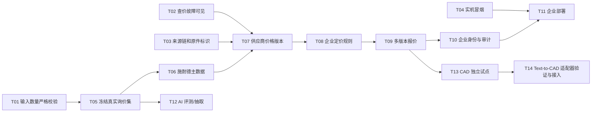

# TASKS：报价 Agent 开发计划与验收清单

| 项目 | 内容 |
|---|---|
| 计划版本 | 1.0，2026-10-22 |
| 技术基线 | 应用 `0.5.0`；需求以 [PRD V3.1](PRD.md) 为准 |
| 使用方式 | 按依赖顺序领取任务；完成后填证据、测试结果、Git 提交和教程链接 |
| 状态 | `[x]` 已有代码与自动测试；`[ ]` 未完成；“待资料”指需要企业输入，不表示停止其他任务 |

技术边界见 [SYSTEM_DESIGN](SYSTEM_DESIGN.md)。本计划只写当前代码可核实的完成项和能够验收的下一步。**60 项自动测试通过不代表企业验收。** 每项开发遵循“先实现→运行适当测试→更新 `docs/learning/` 对应教程→更新学习进度→提交 Git”；教学状态仍由学习者自己填写。

## 1. 已完成的原型基线（不重复开发）

| 编号 | 现有能力 | 代码/测试证据 | 未完成的业务部分 |
|---|---|---|---|
| B01 [x] | Excel 上传、常见列名映射与数据模型 | `app/main.py`、`app/parser.py`、`tests/test_parser.py`、`tests/test_upload_limits.py` | 数量输入严格校验、真实格式集 |
| B02 [x] | 施耐德/CNY/精确产品属性价格准入，缺价人工处理 | `app/product_policy.py`、`app/db.py`、`app/agent.py`、`tests/test_product_policy.py` | 企业产品主数据、供应商价格、故障区分 |
| B03 [x] | `Decimal` 草稿计算：成本 × 1.2、单价到分、行价与规则 ID | `app/pricing.py`、`tests/test_money.py` | 税、折扣与完整成本范围签核 |
| B04 [x] | SQLite 任务快照/事件、恢复、版本冲突和补价幂等 | `app/db.py`、`tests/test_task_persistence.py` | 原件/来源链、备份和多用户验收 |
| B05 [x] | 本机三角色顺序审批与冻结客户报价第 1 版 | `app/auth.py`、`app/approval.py`、`tests/test_approval.py` | 企业身份、变更版、正式审批矩阵 |
| B06 [x] | 内部/客户 Excel 与 Word、客户字段隔离 | `app/exporter.py`、`app/word_exporter.py`、`tests/test_quote_journey.py` | 正式模板、目标软件人工验收 |
| B07 [x] | 自然语言窗口、六款官方产品事实检索、四个只读工具和确定性型号比较 | `static/index.html`、`data_sources/schneider_products.json`、`app/knowledge.py`、`app/assistant.py`、`tests/test_chat.py` | 真实模型、授权完整目录和业务问题评测 |

已实现功能不等于生产可用。历史标签 `v0.4.0-prototype` 标记前一代码原型；本轮 `v0.5.0-prototype` 增加官方产品 RAG 和型号工具。尚无远程 Git 备份。

## 2. 优先级与依赖图



这张图表示**业务上最稳妥的顺序**，不是所有任务都必须串行。T01–T04 可在等待企业资料时独立推进；T05–T08 需要真实或经许可的脱敏输入。T12 的只读问答评测可先于多版本，非结构化抽取须等标注集。CAD 不能仅靠现有三款外形尺寸启动。

## 3. 下一迭代：不依赖企业新资料的工程任务

### T01 [ ] 拒绝不可靠 Excel 数量（最高优先级；PRD F01）

- **原因**：`app/parser.py::parse_excel` 目前用 `int(row["quantity"])`，小数会被截断，空数量填 1。客户要 1.5、2 或漏填时不能悄悄改变需求。
- **实施**：明确首期仅接受正整数数量；逐行检查空值、布尔值、小数、非数字、非正数与超大数，并返回可定位的工作表/行号错误。保留已有表头别名和空名称行处理规则，但对被跳过行的处理应写入导入报告或明确拒绝，不能默默漏报有效需求。
- **改动位置**：`app/parser.py`、必要时 `app/models.py`/`app/main.py`；`tests/test_parser.py`、上传接口测试；同步教程 `docs/learning/02-Excel输入与数据模型.md`。
- **验收**：`2.5`、空值、`0`、负数、文本等输入不创建报价任务；正确整数仍可报价；错误指出原表行；已有回归测试全通过。

### T02 [ ] 区分“无价”与“查价失败”（PRD F03/F06）

- **原因**：`app/db.py::search_local_price` 当前捕获数据库异常后返回 `[]`，任务可能误把系统故障解释成供应商无价。
- **实施**：把数据库读失败转成明确的应用错误/失败状态；保持正常无记录时进入待人工。API 给可操作的错误信息，日志保留故障类别和任务 ID，不泄露凭证。
- **改动位置**：`app/db.py`、`app/agent.py`、`app/main.py`，数据库异常路径测试；更新教程 03/04/08。
- **验收**：模拟数据库不可读时不得进入“仅缺价”路径或发布；正常无合格价仍可人工补价；没有半写入的任务或事件。

### T03 [ ] 完整保存报价来源链（PRD F03/F06）

- **原因**：自动价的 `source_reference`、有效期和核准信息在价格记录中存在，但 `QuotationItem`/发布快照主要保留来源名称与金额；上传原件未持久关联任务。当前难以从报价行还原采用的是哪份供应商凭证。
- **实施**：为采用价格建立稳定价格记录 ID 或不可变价格快照；报价项记录来源 ID、凭证标识、价格生效条件及规则 ID；保存上传原件哈希/受控路径与任务关联。人工成本价也需录入凭证字段或标识“待采购凭证”，不能伪装自动核准价。迁移已有 SQLite 数据时显式标记来源未知，不猜填。
- **改动位置**：`app/models.py`、`app/db.py`、`app/agent.py`、导出/响应的权限白名单、迁移与追溯测试；更新教程 03/08/09。
- **验收**：给定客户报价行可定位冻结的成本、来源凭证和规则；价格库之后修改不改变旧快照；技术/客户响应和文件不泄露供应商成本凭证。

### T04 [ ] 形成可复现的实机冒烟记录（PRD F08/F09/F14）

- **原因**：现有 60 项自动测试多为接口或模型协议模拟；真实浏览器、目标 Word/Excel、Docker 和真实模型未验收。
- **实施**：用**合成数据**走上传→补价→审批→内部/客户 Excel/Word，逐项记录浏览器表现和文件版式；有 Docker CLI 才验证 Compose 与数据卷；有模型授权/密钥才测真实问答与工具调用。把环境、命令、截图/问题和结论放入不含客户信息的验收记录。
- **改动位置**：优先 `docs/` 的验收记录；发现缺陷再改相应代码和教程 05/12/13/14。
- **验收**：每项标“通过/失败/未具备条件”，不能把未执行项写成通过；文件不泄露成本；服务重启后任务可恢复。容器或模型条件缺失不阻止完成其他任务。

## 4. 业务资料到位后的报价试点

### T05 [ ] 建立脱敏冻结验收集（PRD F01/F12；依赖 Q01）

- **输入**：业务负责人提供至少 5 类真实格式的可用脱敏询价，标注原始行、型号、数量、单位、预期拦截/澄清原因；取得使用许可。
- **实施**：定义样本目录、版本、数据许可、人工金标准和评测脚本；敏感原件留在受控存储，不提交 Git。先让当前解析器运行，记录差异，再按差异改列映射。
- **验收**：每次评测可复现；逐行有预期与实际、差异类别和人工裁定；公开仓库只有合成夹具与汇总指标。无真实资料时状态保持“待资料”，不得以示例询价表充数。

### T06 [ ] 施耐德产品主数据与技术确认（PRD F02/F11；依赖 T05、Q02）

- **输入**：经许可的施耐德正式目录、型号属性、单位、别名、替代规则与技术人员确认记录。
- **实施**：为产品建立稳定 ID/版本；精确硬约束过滤与候选列表分开，低置信度转人工；官方页面链接仅作资料出处，不证明安装可行或采购价格。
- **改动位置**：`app/product_policy.py`、产品模型与数据层、测试；新增对应 `docs/learning/` 模块。
- **验收**：同名异型、品牌冲突、缺参数、停产/替代样本不会错误自动接受；候选均带证据和待确认属性。

### T07 [ ] 经采购核准的供应商价格版本（PRD F03/F11；依赖 T02/T03/T06、Q03）

- **输入**：脱敏供应商报价及采购签核字段：币种、单位、税、有效期、交期、起订量、阶梯价、来源凭证。
- **实施**：建立价格版本与受控导入/复核流程；多条有效价展示差异，企业确定选价策略前不自动取最低/最新；过期、税口径未知或单位不符时阻断自动采用。
- **改动位置**：`app/models.py`、`app/db.py`、`app/product_policy.py`、`app/agent.py`，数据库迁移和测试；新增价格主数据教程。
- **验收**：用采购签核样本逐行验证准入与来源；旧报价仍引用当时版本；没有真实价格时只能做合成数据测试。

### T08 [ ] 企业正式定价规则与审批矩阵（PRD F05/F07；依赖 T07、Q04/Q05）

- **输入**：商务、财务和技术签核的手算样例、税/运费/辅材/人工范围、舍入顺序、折扣和最低利润，以及岗位/额度审批规则。
- **实施**：把草稿 `draft-cost-times-1.2-v1` 与正式规则分开，规则有版本、生效期、批准记录；按批准矩阵执行审核，不能只设置 `QUOTE_APPROVED_RULE_ID` 就认定企业签核。
- **验收**：所有签核样例金额逐项一致；旧报价规则不可被新规则改写；缺税或缺成本项不能外发。

## 5. 生命周期、身份与交付

### T09 [ ] 报价第 2 版、退回/作废和发送记录（PRD F13；依赖 T03/T08、Q07）

- **实施**：依据真实议价/技术变更案例设计 `QuoteRevision` 父子关系、变更原因和重审；旧快照不可覆盖。客户文件关联准确版本与内容哈希，外发仅登记操作和责任人；现阶段不自动向客户发送。
- **验收**：改数量/型号/成本/条款后生成新版并重新审批；第 1 版金额、文件和审批记录保持原样；作废版不可作为当前客户版下载。新增版本/回归测试及教程。

### T10 [ ] 企业身份、任务级权限和审计策略（PRD F14；依赖 Q06）

- **实施**：与企业账号体系对接或确定受控登录方式；在 API、问答、导出和事件查询上统一检查任务归属/角色。明确审计留存、删除、管理员权限与密钥轮换；不能让管理员自动具有商务签核权。
- **验收**：无关项目人员无法通过猜任务 ID 查看数据；角色成本隔离在 API、文件、问答均成立；越权操作留审计但不改状态。新增权限测试与教程。

### T11 [ ] 备份恢复与部署验收（PRD F14；依赖 T04/T10、Q06）

- **实施**：确定单机/内网环境、数据目录、备份频率、恢复目标、日志与故障告警；验证 Docker Compose 或经批准的本机部署，演练数据库和文件一起恢复。
- **验收**：恢复后任务、事件、报价快照及文件版本一致；密钥不在镜像/Git；容器健康检查与权限有效；记录实际环境和故障演练结果。部署地点未定时不要预选云服务或微服务。

## 6. 受控 AI 与 CAD 扩展

### T12 [ ] RAG/Tool Calling 离线评测，再决定 AI 抽取（PRD F10/F15；依赖 T05/Q06）

- **实施**：先冻结有许可的中文业务问题、可引用答案、无答案样本和越权请求，评测当前六款官方资料检索、引用、拒答、工具选择与权限。扩大产品目录时保留文档版本/来源；只有非结构化询价标注与授权到位才新增抽取，并让关键字段回到人工确认。
- **验收**：报告样本数、错误类别、人工判定和真实模型版本；无资料时不造价格/尺寸，未经授权不泄露成本，模型不能调用写工具。是否引入向量索引由数据量与评测结果决定。

### T13 [ ] 一个柜型的确定性二维 CAD 基线（PRD F16；依赖 T06/T09、Q08）

- **输入**：工程师核准的一个柜型、安装板尺寸与有效区域、孔位/禁布区、5–10 种元器件的二维外形/安装信息、方向、净空/间距规则、BOM 和批准布局样例；所有资料需有来源及版本。
- **实施**：定义共享版本引用的 `BOMSnapshot` 和结构化 `DesignSpec`；先实现确定性布局基线、DXF/预览生成和独立校验器。校验 BOM 数量、边界、禁布区、碰撞和已确认间距。保存输入快照、产物哈希、校验报告、工程师意见和修改版本。
- **验收**：缺少尺寸/约束时明确阻止生成；错误定位到元件和规则；失败图不能标记为通过；工程师审核能追溯每个尺寸和修改；任何产物仅标记为待审核二维初稿，不能宣称可投产。BOM/成本变化触发 T09 新报价版本及审批；CAD 不成为报价主链的隐性前置条件。

### T14 [ ] Text-to-CAD 开源方案验证与受控适配（PRD F16；依赖 T13、Q08）

- **目标**：验证用户指定/选定的开源 Text-to-CAD 项目是否适合“单柜型、5–10 种元器件、二维安装板布局初稿”。在验证结果支持前，不将其视为既定技术选型或当前功能。
- **验证输入**：固定版本/提交、许可证与运行要求、同一组已批准 `DesignSpec` 和 T13 的确定性基线、目标输出格式。形成小型隔离技术验证，不接真实客户数据、供应商成本或生产凭证。
- **验证内容**：确认其输出究竟是二维几何、DXF、结构化布局还是可执行代码；记录可控参数、重复运行稳定性、格式转换损失、资源消耗、依赖、许可证和失败模式。比较输出是否能通过与确定性基线相同的独立校验器。
- **适配设计**：只有验证通过后才实现 `TextToCAD2DAdapter`，遵循 `CAD2DGenerator` 接口。优先让模型/开源组件输出 schema 校验的布局数据，再由确定性 DXF 生成器绘图。不得直接执行未审查的任意模型代码；若上游强制生成代码，须使用无网络、无密钥、无宿主目录权限、资源和时间限额的隔离执行环境，并限用白名单 API。确定性模板/布局生成器始终可作为回退。
- **修复闭环**：候选 `CADGenerationRepairAgent` 只接收结构化校验错误，可在白名单工具、最大轮数、总时限和最大产物大小内提出受限修改；每轮重跑全部校验。缺数据、规则冲突、超限或反复失败时停止并交工程师。Agent不能改BOM、产品尺寸主数据、价格或审批状态。
- **验收**：通过固定验证集报告DXF/布局生成成功率、硬约束错误率、首次校验通过率、修复后通过率、失败类别及运行成本；与T13确定性基线对比并保留逐例结果。任何硬约束失败均不能作为通过产物。工程师对盲化样例记录审核通过、修改量和退回原因；没有工程师确认不报告工程可用性。若开源方案不满足格式、隔离、许可证或质量要求，记录结论并保留确定性方案，不接入产品。

## 7. 每项任务的完成记录模板

```text
任务编号/PRD 编号：
状态：未开始 / 开发中 / 待资料 / 已完成
输入资料与授权：
修改代码文件：
新增或更新测试、结果：
未验证的实机/业务条件：
更新的 docs/learning/ 教程与学习进度：
Git 提交/标签：
业务验收人及证据（如适用）：
```

开发任务只有在代码、错误路径、回归测试、教程和 Git 提交齐备后才能标 `[x]`。依赖企业资料的任务还需记录批准人和样本版本；没有输入时可完成设计/合成测试，但不能把业务验收状态改为完成。下一次迭代优先领取 **T01**，并行准备 T02–T04；之后根据企业提供的 Q01–Q08 资料决定 P1 的实际顺序。
