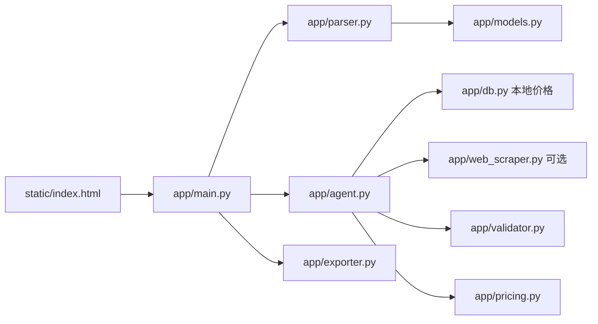

# 现状与开发顺序

> 本文保留 2026-10-20 的开发前基线。2026-10-21 已完成金额、[人民币与施耐德产品匹配](07-人民币与施耐德产品匹配.md)、[任务持久化](08-任务持久化与操作审计.md)及[本机审批与客户版](09-角色审批与客户报价.md)；当前状态以[学习进度](学习进度.md)为准。企业规则、真实数据和正式身份体系仍待确认。

## 我们现在有什么

实际项目根目录：本仓库根目录。教程中的本地路径均使用相对路径，避免暴露开发者电脑信息。

入口 `run.py` 启动 `app/main.py` 的 FastAPI；`static/index.html` 通过 `/upload` 传 Excel，`app/parser.py` 产生 `Product`，`app/agent.py` 用 LangGraph 串起本地查价、价格核查和计算。缺价时任务写入 SQLite 等待 `/tasks/{id}/confirm`；`/export` 生成 Excel 或 Word。自然语言区接入 `app/knowledge.py` 小规模资料检索与两个只读工具；不参与金额计算。仓库未见 Streamlit 代码，`requirements.txt` 也没有 Streamlit。

现有 `tests/test_parser.py` 只测列名、分类和 Excel 解析；2026-10-20 在项目虚拟环境执行 `.venv/bin/python -m pytest -q -p no:cacheprovider` 得到 **3 passed**。未进行网页实测、浏览器端到端测试或真实业务验收。直接调用 `.venv/bin/pytest` 在本机测试收集阶段报 `ModuleNotFoundError: app`；使用 `python -m pytest` 可正确从项目根目录导入。

## 按风险安排开发与教学

| 顺序 | 下一开发模块与验收重点 | 为什么先做 | 教程 |
|---|---|---|---|
| 1 | **金额与报价契约（已完成技术改造，业务规则待确认）**：`Decimal` 贯穿新价格存储、输入、计算与接口；单价先舍入、行价后计算；补充测试 | 原有 `float` 造成可见数字可能对不上；旧库存储精度无法恢复，企业规则仍待确认 | 已更新 `03` |
| 2 | **产品与价格匹配（已完成原型技术改造）**：任务内明细 ID、施耐德与人民币价格准入、完整补价、停用演示种子和网页自动采用 | 同名不同型号不再串价；无真实核准价格时保持待处理 | 已新增 `07` |
| 3 | **API 与导出闭环（技术实现完成，业务待确认）**：内部草稿与冻结客户版分离，顺序审批与规则闸门已接入 | 内部草稿包含成本，客户版需企业正式模板和规则签核 | 更新 `05`、新增 `09` |
| 4 | **工作流持久化与可追踪（本机实现完成）**：保存任务、人工补价、事件、规则和审批，验证重启恢复及重复请求 | 多实例、企业实名身份和后续报价版本尚待实现 | 更新 `04`、新增 `08` |
| 5 | **外部价格与受控 AI**：先验证稳定数据源和来源证据，异常价转人工；只有非结构化询价或模糊匹配的实际需求明确时加入模型节点 | 网页抓取仍是可选适配器；资料检索与只读工具仅辅助问答，不能决定最终成本 | 更新 `06`，继续扩展 `15`、`16` |

这些是建议顺序，不表示全部已有需求已经由企业确认。CAD 出现在上级 `项目需求总结_v2.md` 的远期范围，当前报价仓库没有 CAD 代码；先把报价链路做成可验证闭环，再评估 CAD。Streamlit 是可选界面方案，不应仅因“预期技术栈”而替换当前可用页面。

## 优先排查的实际问题

- `app/pricing.py` 的 `calculate_item_price` 用 `float`；行总价从未舍入单价相乘，可能与导出单价 × 数量不一致。
- `app/db.py` 的 `search_local_price` 使用名称或型号模糊匹配；`seed_sample_data` 每次启动插入记录。
- `app/agent.py` 的 `validation_results`、`manual_prices` 以产品名称为键；`human_review_decision` 只看是否有人工价格字典，`apply_manual_prices` 不要求全部待确认项都有价。
- `app/main.py` 的 `/export` 与 `static/index.html` 的请求契约不一致；`app/exporter.py` 会写出成本价和利润率。
- `app/main.py` 的异步上传函数内部调用同步 Excel 解析、同步工作流和网页查价，长任务可能阻塞请求处理；网页适配器受页面变化、登录要求和运行环境影响。
- `docs/项目代码全解.md` 的部分“面试答案”把未实现能力说成现状。学习时以代码与测试为证据。

当前先阅读 [Excel 输入与数据模型](02-Excel输入与数据模型.md) 的“数据流”与“核心代码”，随后阅读金额模块。每个阶段开发前只核对这一阶段的业务规则，不做无条件重构。
