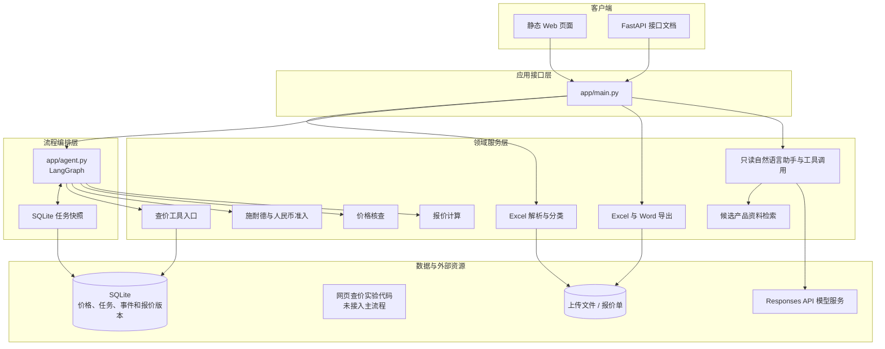
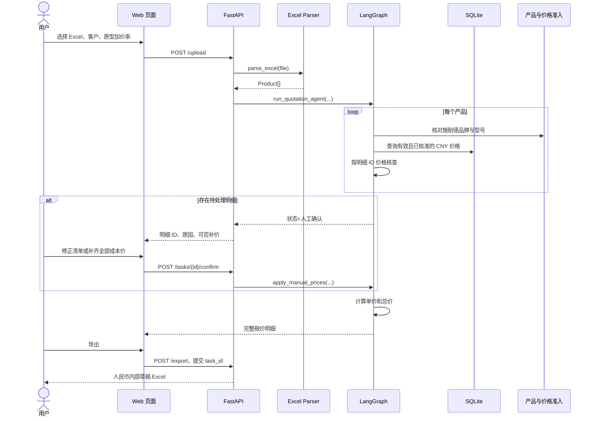
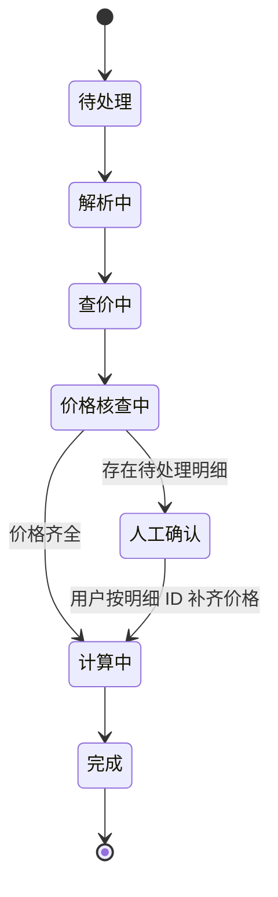

# 电气产品 AI 智能报价 Agent：架构设计

## 1. 文档目的

本文说明当前系统的架构、核心数据流、模块边界和运行约束，并给出从本地原型演进到真实业务系统的建议。内容以当前仓库代码为准，区分已经实现的能力和后续建议。

## 2. 系统定位

系统接收电气产品 Excel 清单，以人民币 CNY 报价，并要求上传清单各行符合施耐德品牌与型号约束。只自动采用同型号、规格、单位且有来源、有效期和核准标记的本地价格；其他行进入待处理。

当前适合单机开发和业务流程演示。真实成本、客户资料和报价结果属于敏感业务数据；现有 SQLite 快照和本机令牌不等于企业正式身份、审计与备份，进入正式业务前仍需完善。

## 3. 架构总览



系统采用单体分层结构。FastAPI 负责 HTTP 边界，LangGraph 负责报价步骤顺序，各领域模块分别处理解析、查价、核查、定价和导出。SQLite 与本地文件系统构成当前的数据层。自然语言助手先检索 `data_sources/schneider_products.json` 中六款有官方来源的施耐德产品事实，模型可以调用任务摘要、资料搜索、精确型号详情和型号比较四个白名单只读工具；任务资料按角色过滤后才作为工具结果发送。模型不参与工作流决策和金额计算；客户 Excel 与 Word 都读取审批后的冻结版本。可选 Docker Compose 只改变本机启动方式。

## 4. 核心报价时序



### 4.1 状态流转



`QuotationStatus.ERROR` 已在模型中定义，但当前流程没有统一异常节点。异常主要由 API 返回 HTTP 错误，或由查价工具降级为空结果。

## 5. 模块职责

| 模块 | 职责 | 当前边界 |
|---|---|---|
| `app/main.py` | HTTP 接口、上传保存、调用流程、下载文件 | 包含部分响应转换和文件路径逻辑 |
| `app/agent.py` | 定义 LangGraph 节点、分支和任务状态 | 应用层将关键状态写入 SQLite，尚无 LangGraph 内置 checkpoint |
| `app/models.py` | 产品、价格、报价项和状态模型 | 金额使用 `Decimal`；企业规则尚待确认 |
| `app/parser.py` | Excel 读取、列名统一、产品分类 | 依赖输入表头，分类使用关键词规则 |
| `app/db.py` | SQLite 价格、任务快照、事件和冻结版本 | 只自动采用有完整元数据的施耐德 CNY 价格；旧价格不自动采用 |
| `app/auth.py`、`app/approval.py` | 本机令牌角色、三阶段审批和发布闸门 | 需企业实名身份与规则签核后才能正式使用 |
| `app/product_policy.py` | 施耐德品牌与人民币价格准入 | 规则覆盖清单每一行，正式产品目录尚缺 |
| `app/tools.py` | 本地查价、网页查价和核查入口 | 主要是薄封装 |
| `app/web_scraper.py` | Playwright 适配器和抓取降级 | 页面选择器易受网站变化影响 |
| `app/validator.py` | 价格范围与历史偏差检查 | 警告不阻断报价，范围写在代码中 |
| `app/pricing.py` | 单项和批量报价计算 | 原型公式按 `Decimal` 和固定舍入规则执行 |
| `app/exporter.py` | 创建内部与客户 Excel | 客户版只从已发布快照取公开字段；模板条款仍待企业确认 |
| `app/retry.py` | 指数退避重试与兜底 | 使用同步阻塞等待 |
| `app/knowledge.py` | 从六款官方产品事实清单检索、按完整型号查询并比较 | 小规模词项和电气参数约束检索，来源可追溯；不检索供应商价格 |
| `static/index.html` | 上传、恢复、补价、审批和导出 | 单页原生前端，令牌仅保留当前页面 |

## 6. 领域模型

### Product

报价输入的标准产品结构，包含名称、型号、规格、品牌、类别、数量和单位。产品名称及数量是 Excel 解析所需的最小字段。

### PriceRecord

价格候选记录，包含产品名称、型号、来源、价格、可信度和抓取时间。当前流程取本地查询结果的第一条记录。

### QuotationItem

单条报价结果，包含产品、成本价、加价率、折扣、单价、总价、备注、价格来源、精度标记、原型规则 ID 和舍入方式。价格来源在查价和人工补价路径中填充；来源凭证和审批信息尚未建立。

### GraphState

一次报价的运行状态，包括任务编号、客户、原型加价率、产品、报价项、状态、消息、待确认产品、人工价格和核查结果。代码字段名 `profit_rate` 为旧接口名，当前公式按加价率解释。

任务及版本号写入 SQLite，服务重启后可按任务 ID 恢复。多进程和横向扩容尚未验收；当前是本机运行方式。

## 7. 数据与存储

### 7.1 SQLite

数据库文件为 `data/quotation.db`，包含：

- `price_records`：本地及历史价格记录
- `quotation_tasks`：任务快照和乐观并发版本
- `task_events`：状态与审批事件
- `quote_revisions`：已发布报价的不可覆盖快照，当前只实现第 1 版

本地查询先按精确产品名称筛选，再逐项核对施耐德品牌、型号、规格、单位、CNY、价格有效期、来源凭证和 `verified` 标记。旧记录没有这些元数据，不自动采用。`verified` 是技术标记，不是有身份与审计记录的正式审批。

### 7.2 文件系统

- 上传文件保存到 `data/uploads/`
- 导出文件保存到 `data/`
- 本地数据库也位于 `data/`

`data/` 已从 Git 排除。生产环境应限制文件类型和大小，清理过期文件，对上传内容做安全检查，并定义加密、备份和保留期限。

### 7.3 配置

`app/config.py` 提供数据目录、数据库路径、默认原型加价率、默认折扣、舍入常量和日志配置。`.env.example` 中的 OpenAI 配置尚未被主流程读取。

后续应使用统一配置模型，从环境变量加载数据库、允许来源、文件限制和外部服务配置。

## 8. 查价与价格核查策略

查价顺序：

1. 核对上传清单的施耐德品牌与型号；不合格时要求修正并重新上传。
2. 在本地 SQLite 查找属性完全一致、CNY、来源和有效期完整且标记核准的价格。
3. 无合格价时按明细 ID 人工补价。网页抓取适配器保留为实验代码，不自动进入报价。

价格核查顺序：

1. 检查价格是否大于零。
2. 对预设产品名称检查常见价格区间。
3. 取最多五条历史价格计算平均值。
4. 新价格与历史均价偏差超过 30% 时给出警告。

核查警告会加入报价备注，但不会阻断报价。生产规则应明确哪些异常只提示、哪些必须审批、哪些必须拒绝。

## 9. 定价规则

当前公式：

```text
原型报价单价 = 成本价 × (1 + 加价率) × 折扣，再按当前规则舍入到分
报价行价 = 舍入后单价 × 数量
```

当前原型以 `Decimal` 计算人民币金额：单价按 `ROUND_HALF_UP` 舍入到分，行价由舍入后单价乘数量得出。报价项保留规则 ID 和舍入方式，新价格存入 SQLite 的 `price_decimal` 文本列；旧 `REAL` 价格无法恢复原始精度。正式业务仍须确认加价或毛利率口径、税、运费、阶梯价和舍入时点。

## 10. API 边界

### `POST /upload`

使用 `multipart/form-data` 提交 `file`、`customer_name` 和 `profit_rate`，返回任务编号、状态、报价项、流程消息和待确认产品。

### `GET /tasks/{task_id}`

读取 SQLite 中的任务状态。任务 ID 不存在时返回 404。

### `POST /tasks/{task_id}/confirm`

请求体为任务内明细 ID 到人民币成本价的映射；须一次补齐全部可补价明细：

```json
{
  "line-1": "45.00",
  "line-2": "38.50"
}
```

品牌或型号不符合施耐德规则时，接口拒绝仅靠补价完成任务；需修正清单重新上传。

### `POST /export`

请求体为 `{"task_id":"...","format":"internal"}` 或 `"customer"`。内部版读取已完成任务；客户版要求商务令牌及三阶段审批后的冻结快照。未配置企业核准规则 ID 时禁止客户版本发布。

## 11. 安全与数据治理

正式业务至少需要：

- 用户登录、角色权限和客户数据访问控制
- 使用环境变量或密钥管理服务保存 API Key
- 上传文件扩展名、MIME、大小和内容校验
- 如需跨域部署，应明确配置 CORS 允许来源；本机页面与 API 同源，当前不开放跨域
- 报价创建、改价、确认、导出和下载的审计记录
- 成本字段与客户外发报价字段隔离
- 敏感数据加密、备份、恢复和删除策略
- 外部网站数据源的使用授权、频率控制和可追溯性

## 12. 可观测性与故障处理

当前系统使用 Python 标准日志，网页查价最多重试三次并指数退避。后续建议：

- 为一次报价生成贯穿 API、流程节点、查价和导出的关联 ID
- 使用结构化日志，避免记录密钥、完整客户数据和成本表
- 记录各数据源的耗时、命中率、错误率和人工确认率
- 区分可重试错误、业务校验错误和系统错误
- 将失败状态持久化，并向用户展示可操作的错误信息

## 13. 推荐演进路线

### 第一阶段：让原型可信

1. 金额计算已改用 `Decimal` 并补充定价测试；下一步确认企业公式、舍入规则，复核旧库和网页价格。
2. 已用明细 ID 取代产品名称作为人工确认键，补价须完整提交。
3. 已停止启动时插入演示价格；后续导入真实施耐德产品及供应商价格。
4. 已区分内部成本版与客户版，并用三阶段审批和规则闸门保护发布；正式模板待企业确认。
5. 为上传、查价、确认、导出补充 API 集成测试。

### 第二阶段：让数据可管理

1. 已将任务、报价项、审批事件和第 1 版报价快照持久化；后续增加变更版本与保留策略。
2. 建立产品主数据、供应商价格、历史成交价和规则版本。
3. 当前已有品牌别名归一及型号、规格、单位严格匹配；后续建立经核准的产品主数据和替代关系。
4. 当前有价格有效期、来源引用、技术核准标记和本机审批事件；后续接入企业实名身份与不可抵赖审计。

### 第三阶段：支持多人业务

1. 使用 PostgreSQL，将短期流程状态移到 Redis 或持久化工作流系统。
2. 加入企业身份认证和角色权限。
3. 将网页查价放入异步任务队列，避免阻塞 HTTP 请求。
4. 部署反向代理、TLS、监控、告警和自动备份。

### 第四阶段：引入受控 AI 能力

AI 更适合用于自然语言需求抽取、产品描述标准化和候选匹配解释。价格计算、折扣规则、审批条件和最终导出应继续由确定性代码执行。所有 AI 结果需经过结构校验，并保留输入、模型版本、输出和人工修正记录。

## 14. 架构决策摘要

| 决策 | 当前选择 | 原因 | 后续触发条件 |
|---|---|---|---|
| 应用形态 | FastAPI 单体 | 原型简单、易调试 | 团队或负载扩大时拆分后台任务 |
| 流程编排 | LangGraph | 清楚表达人工确认分支 | 长任务恢复和并发需要持久化检查点 |
| 业务数据 | SQLite | 本地零配置 | 多用户、审计、并发时迁移 PostgreSQL |
| 任务状态 | SQLite 快照 + 版本号 | 重启恢复、阻止旧版本覆盖 | 多实例/高负载时评估专用工作流存储 |
| 前端 | 原生单页 | 依赖少 | 交互、权限和路由增加时工程化 |
| 网页查价 | Playwright 适配器 | 可验证外部数据接入 | 稳定运行需合法 API 或供应商接口 |
| 金额类型 | `Decimal`；新价格另存十进制文本 | 精确复现当前原型规则 | 旧价格与网页价格需复核，正式规则需企业确认 |

## 15. 验证清单

每次架构相关改动至少确认：

- 示例 Excel 可以解析，错误表头能返回明确提示
- 施耐德 CNY 合格价格命中与人工确认两条主路径可运行；网页实验代码不自动采用
- 异常价格会显示核查警告
- 金额计算和舍入符合业务规则
- 导出文件可打开，内部/客户字段符合目标模板
- 服务重启后的任务行为符合设计
- 日志、接口响应和 Git 中不包含密钥及真实敏感数据
